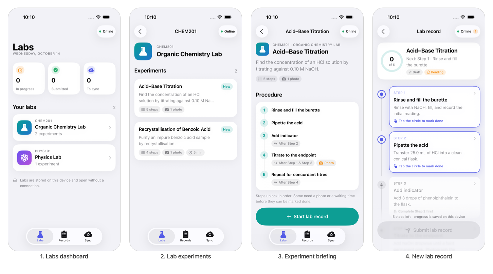
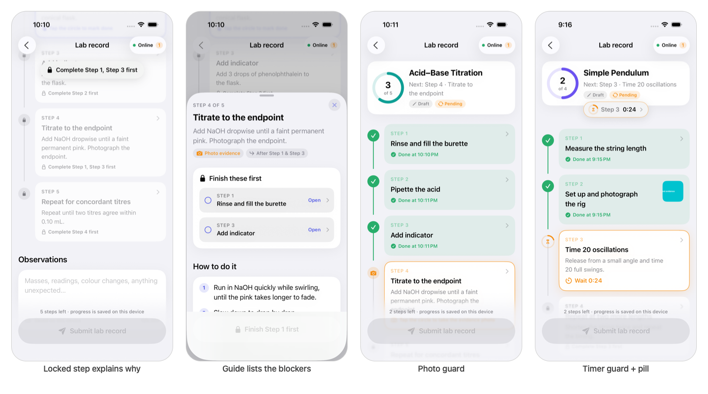
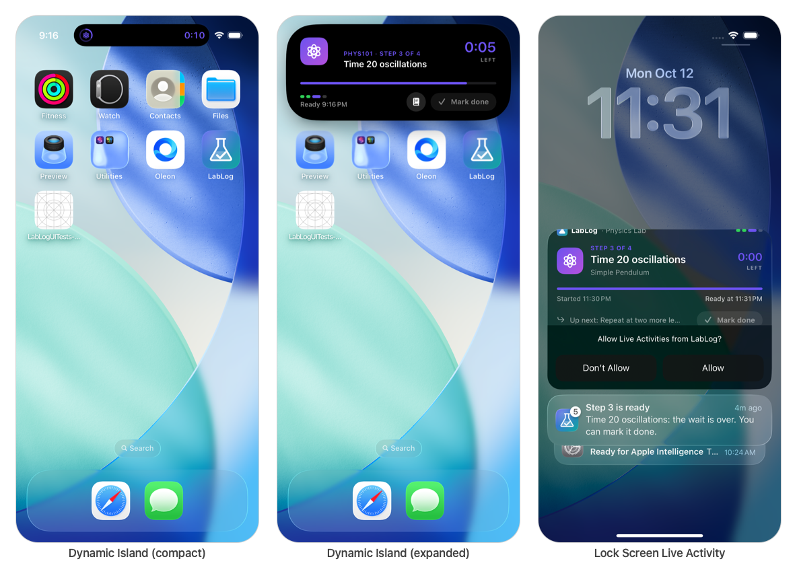
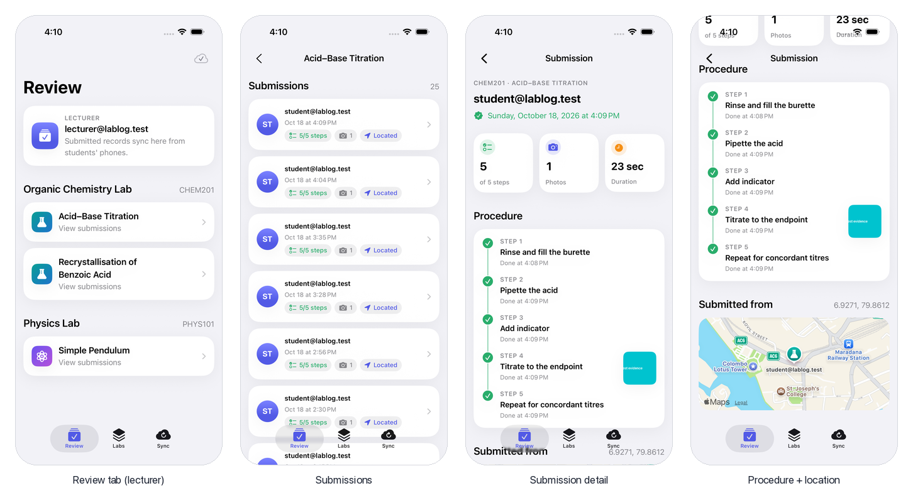
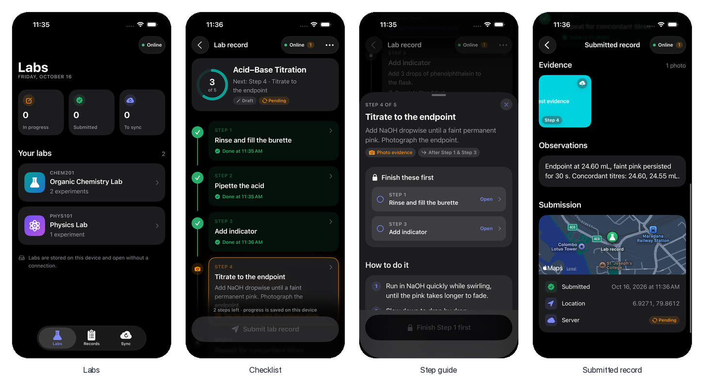
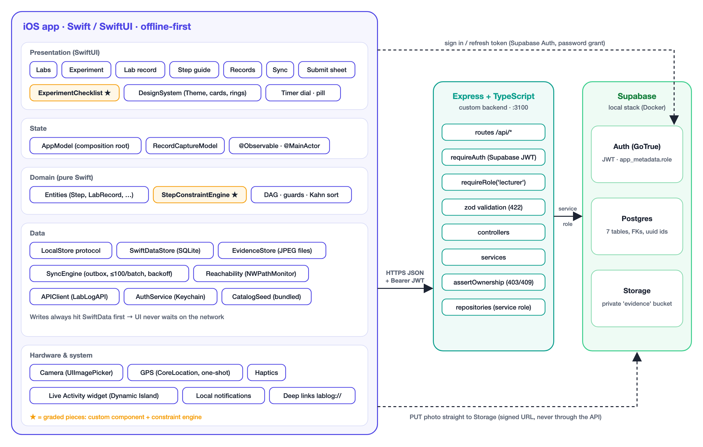

# LabLog — Digital Practical Lab Book (iOS)

An offline-first iPhone app for university practicals. A student works through an experiment as a
**constrained checklist**: steps unlock in order, some need photo evidence or a timed wait. The
student attaches photos, writes observations and notes, and submits a **location-stamped lab record**.
Everything is saved on the phone first and syncs to the backend when a connection returns. Lecturers
review submissions in the same app.

| | |
|---|---|
| **Module** | SE5070 Enterprise Mobility · MSc in IT (Enterprise Application Development), 2026 |
| **Student** | Thanura Manjitha Peiris · MS26928210 |
| **Project area** | 0, Edtech (digits of MS26928210 sum to 30; 30 mod 5 = 0) |
| **Report** | [`docs/LabLog-Report.pdf`](docs/LabLog-Report.pdf) |
| **Backend** | [github.com/thxnura/lablog-backend](https://github.com/thxnura/lablog-backend) (Express + TypeScript + Supabase) |



## How LabLog meets the brief

| Requirement | Where it is |
|---|---|
| Native mobile app | Swift 6 / SwiftUI, iOS 17+, with a widget extension for the Live Activity |
| Backend service | A custom Express + TypeScript API in front of Supabase (Postgres, Auth, Storage); see the backend repo |
| Offline access and sync | SwiftData is the source of truth; an outbox `SyncEngine` uploads photos, then records, when `NWPathMonitor` sees a connection. Idempotent by client UUIDs, with retry and backoff; deletes sync as tombstones |
| Constraint design | `StepConstraintEngine`: a precedence DAG with photo and timer guards, graph validation with Kahn's algorithm, and invariants such as "a completed photo step keeps its photo" |
| Native hardware | Camera (step evidence), GPS (location stamp on submit), Dynamic Island and Lock Screen (Live Activity timer), haptics, notifications |
| Custom component | `ExperimentChecklist`: a timeline checklist with documented properties and events (report §8) |
| Decision records and failure logs | [`docs/decision-records.md`](docs/decision-records.md) (ADR-001 to 023) and [`docs/failure-log.md`](docs/failure-log.md) (16 failures, every AI prompt) |

<table>
<tr>
<td></td>
</tr>
<tr><td align="center"><em>Locked steps explain why; the guide links to the blocking steps; photo and timer guards.</em></td></tr>
<tr>
<td></td>
</tr>
<tr><td align="center"><em>A timed step counts down in the Dynamic Island and on the Lock Screen, with Mark done.</em></td></tr>
<tr>
<td></td>
</tr>
<tr><td align="center"><em>Lecturers review submissions: steps with times, photos, observation and location.</em></td></tr>
<tr>
<td></td>
</tr>
<tr><td align="center"><em>Dark mode: the app follows the system appearance, and every screen was checked in it.</em></td></tr>
</table>

More screens are in the report: submitting (Fig. 6), editing a draft (Fig. 11) and choosing the
server (Fig. 12). All dark-mode screenshots are in
[`docs/screenshots/ui-dark/`](docs/screenshots/ui-dark/).

## Architecture



```
LabLog/
  App/            entry point, AppModel (composition root), config, tabs
  DesignSystem/   theme tokens and shared components
  Features/       one folder per screen: LabList, ExperimentList, ExperimentDetail,
                  RecordCapture (checklist, step guide, submit), Records, SyncStatus, Auth, Review
  Components/     ExperimentChecklist (the custom component), status badges
  Domain/         Entities and Constraints/StepConstraintEngine (pure Swift, unit-tested)
  Data/           Local (SwiftData store, bundled catalog, photo files),
                  Remote (API client, Supabase Auth, Keychain, server address),
                  Sync (outbox engine, reachability)
  Hardware/       camera and location
  LiveActivity/   timer coordinator (Live Activity and "ready" notification)
Shared/           code shared by the app and the widget (activity data, App Intent)
LabLogWidgets/    widget extension: Dynamic Island and Lock Screen
LabLogTests/      47 unit tests
LabLogUITests/    5 end-to-end UI tests
docs/             report, decision records, failure log, screenshots
```

Data flows one way: views send actions to their model, the model asks the constraint engine and
writes to the local store, and the sync engine pushes the outbox to the API in the background. The
report explains each layer (§3) and the offline design (§4).

## Running it

**Requirements:** Xcode 26 or later (built and tested with Xcode 27), an iOS 17+ simulator or device.

### 1. On-device mode (no backend needed)
Open `LabLog.xcodeproj`, choose the **LabLog** scheme and an iPhone simulator, and press Run. The lab
catalog is bundled, so the whole student flow works without a server: browse, complete steps, take
photos, submit. Records stay on the device.

### 2. With the backend (sign-in, sync, lecturer review)
1. Start the backend locally; see the [backend README](https://github.com/thxnura/lablog-backend#readme).
   Its `npm run local:setup -- --host <your Mac's IP>` prints the three values below.
2. Copy `Config/Secrets.example.xcconfig` to `Config/Secrets.xcconfig` (git-ignored) and fill in
   `LABLOG_API_BASE_URL`, `SUPABASE_URL` and `SUPABASE_ANON_KEY`.
3. Run the app and sign in from the **Sync** tab. Demo accounts: `student@lablog.test` /
   `LabLog-Student-1` and `lecturer@lablog.test` / `LabLog-Lecturer-1`.

If the Mac's address changes later (another Wi-Fi, a phone hotspot), set it in the app under
**Sync → Server** and tap **Test connection**; no rebuild is needed.

To run on a physical iPhone, choose your own team under *Signing & Capabilities* for the LabLog and
LabLogWidgets targets.

### Tests
```sh
xcodebuild test -project LabLog.xcodeproj -scheme LabLog \
  -destination 'platform=iOS Simulator,name=iPhone 17 Pro'
```
47 unit tests (constraint engine, local store, sync engine, server endpoint, Live Activity and
guides) and 5 UI tests (the titration flow to submission, the timer and Dynamic Island, sign-in and
sync, lecturer review, and draft editing with the server setting). The UI tests that sign in need
the local backend running.

## Documentation

- [`docs/LabLog-Report.pdf`](docs/LabLog-Report.pdf): the project report.
- [`docs/decision-records.md`](docs/decision-records.md): 23 architecture decision records.
- [`docs/failure-log.md`](docs/failure-log.md): every failure with its exact error, cause and fix, and every AI prompt.
- [`docs/screenshots/`](docs/screenshots/): evidence and UI screenshots (see its README).

All images, the app icon and the diagrams are original. AI assistance (Claude Code) was used as
described in the report (§9.3) and the failure log.
