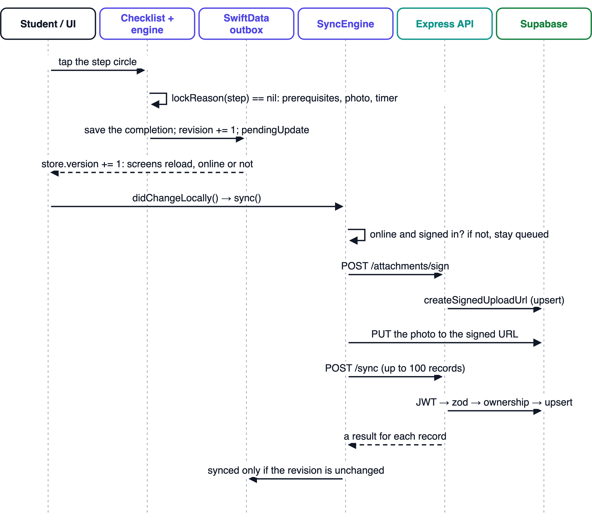
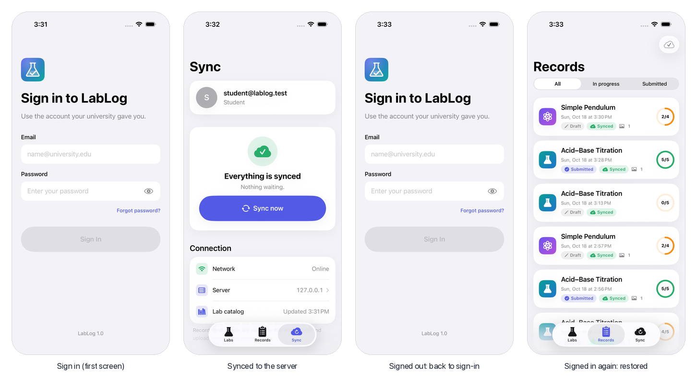
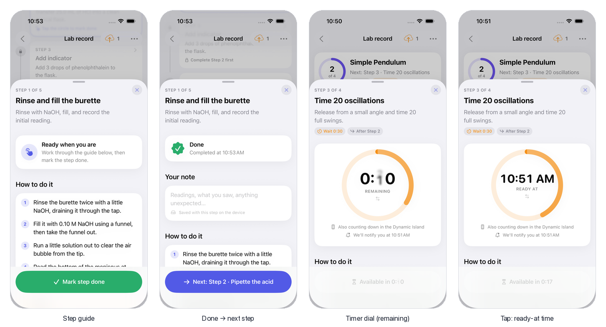
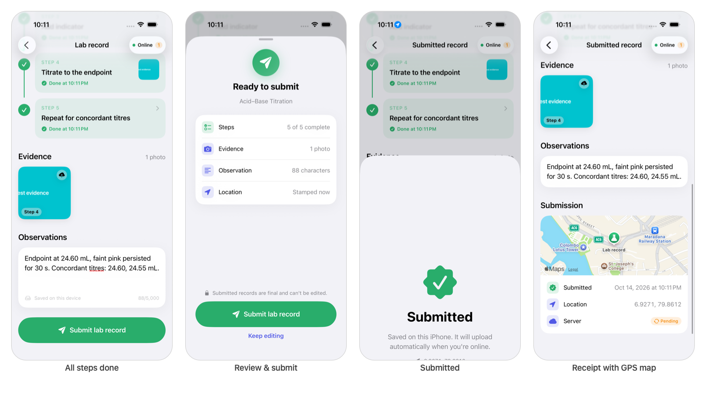
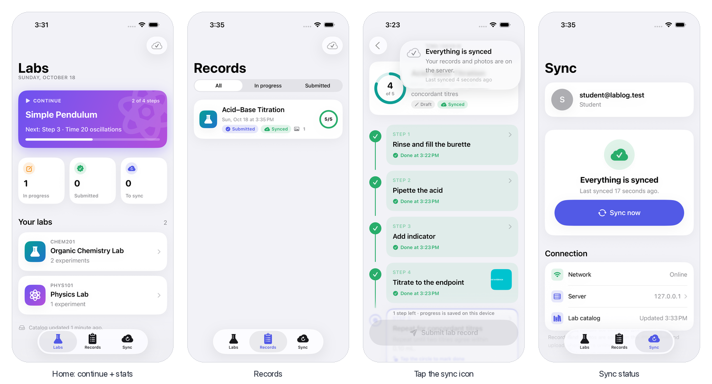
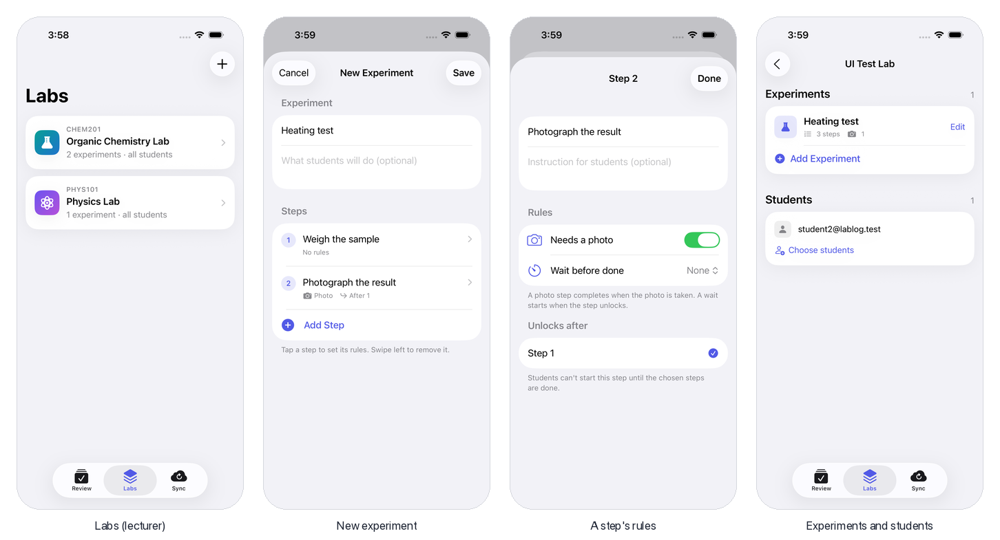
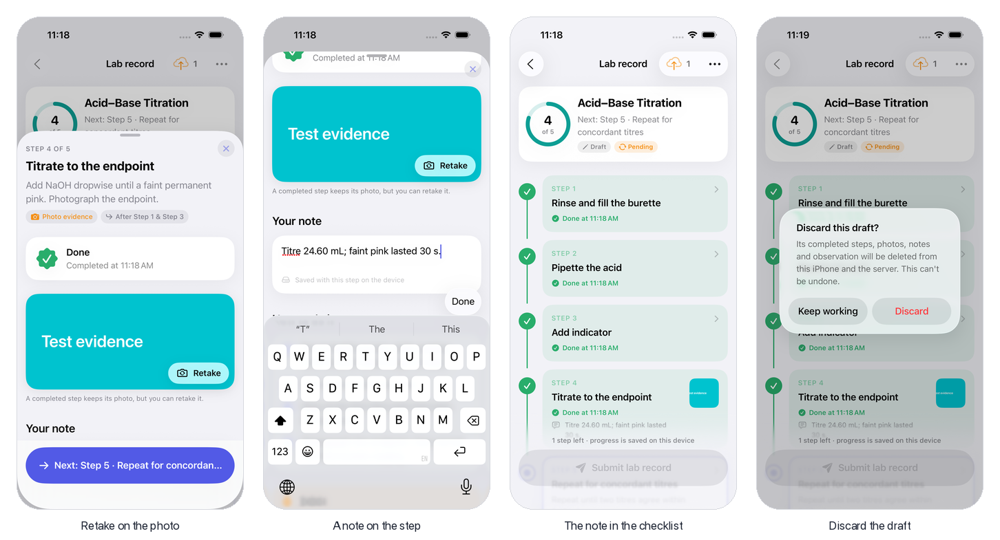
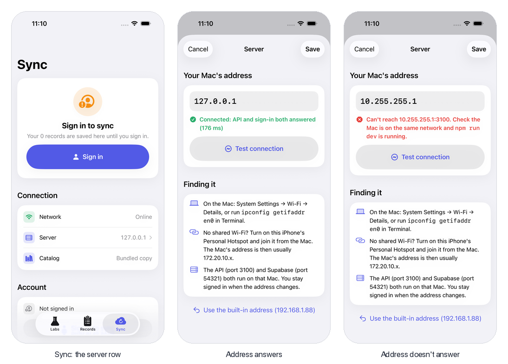
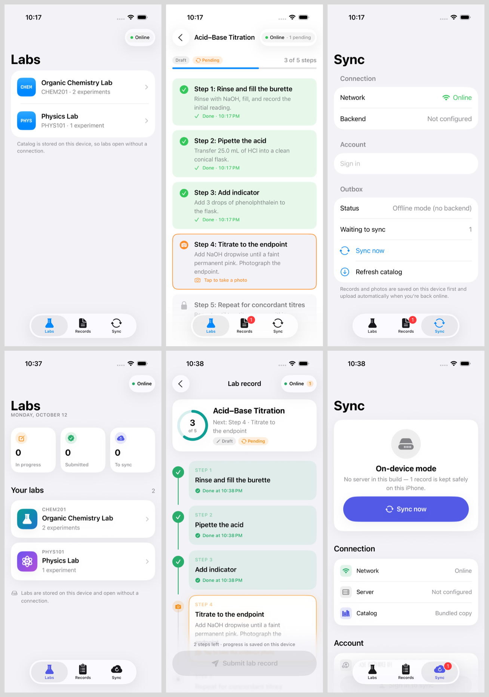

# LabLog: Design and Implementation of an Offline-First Digital Practical Laboratory Book

**SE5070 Enterprise Mobility: Individual Assignment Report**

MSc in Information Technology, Specialised in Enterprise Applications Development
Year 1, Semester 1, 2026

| Field | Details |
|---|---|
| Student | Thanura Manjitha Peiris |
| Student ID | MS26928210 |
| Module | SE5070 Enterprise Mobility |
| Assignment | Individual mobile application development project |
| Project area | 0: Educational Technology (Edtech) |
| Submission date | 18 October 2026 |
| Source code | [iOS application](https://github.com/thxnura/lablog-ios) and [backend service](https://github.com/thxnura/lablog-backend) |

## Abstract / Executive Summary

LabLog is a native iOS application for recording university laboratory practicals. It allows students to record their progress and supporting evidence when an internet connection is unreliable. The project falls within the Edtech domain, as determined by the index-number calculation in the SE5070 assignment brief [1]. The application uses SwiftUI for its interface, SwiftData for local storage, a custom Express and TypeScript backend, and Supabase for authentication, database storage and photographs.

Each experiment consists of steps linked by prerequisites. Some steps also require a photograph or a minimum waiting period. A shared constraint engine checks these conditions before allowing a step to be completed. The application saves changes on the phone first and uploads them later, using an outbox, stable record identifiers, retries and revision checks. Students can attach photographs, add observations and request a location stamp when submitting. Lecturers can create experiments, enrol students and review submitted records.

The evaluation draws on automated tests, development records and checks carried out on the test device [2] to [5]. These show how the application behaved in the tested scenarios; they do not measure its effect on learning. The main limitations are single-author synchronisation, lecturer features that require a connection, and incomplete server-side enforcement of procedural rules. The report explains these limits alongside the design decisions, failures and AI assistance recorded during development.

## Contents

Contents and page references are provided in the Word document.

## 1. Introduction and Project Domain

### 1.1 Project area calculation

The assignment allocates a project domain using the digit sum of the student index number, followed by division modulo five [1]. Table 1 presents the calculation for this project.

*Table 1. Index-number calculation and allocated project domain.*

| Calculation stage | Value or result |
|---|---|
| Student index number | MS26928210 |
| Numerical characters | 2, 6, 9, 2, 8, 2, 1, 0 |
| Digit sum | 2 + 6 + 9 + 2 + 8 + 2 + 1 + 0 = 30 |
| Modulus calculation | 30 mod 5 = 0 |
| Allocated project domain | 0: Educational Technology (Edtech) |

LabLog addresses the allocated Edtech domain by supporting the structured recording and review of university practical work.

### 1.2 Report scope and evidence

This report explains how the mobile application and backend work together, focusing on offline access, procedural constraints, native hardware and custom components. The discussion draws on the source repositories, architecture decisions and failure logs [2] to [5]. The evaluation considers the behaviour of the application. Its effect on student learning has not been assessed in a controlled study.


## 2. Problem Definition, Objectives and Features

### 2.1 Problem definition

LabLog was designed for practical sessions in which students follow a procedure and record observations and evidence. Paper records and general-purpose documents leave students to track step order and evidence requirements themselves. A mobile application can guide that process, but it must also allow work to continue when the network is unavailable. These needs guided the project design; no survey was conducted to establish how common they are across universities.

### 2.2 Proposed solution and objectives

LabLog organises each experiment as a checklist with rules. A student can complete a step only after its prerequisites, waiting period and evidence requirements have been met. The resulting record contains completion times, notes, photographs and observations. The application requests a location stamp during submission, but a missing location does not prevent the student from submitting the record.

The main objectives are to keep practical work available offline, apply the same step rules throughout the app, use the camera and location services, and provide a reusable checklist component. The backend handles sign-in, catalogue access, synchronisation and lecturer operations. Students sign in before using the application and can then continue local work offline. Lecturers have separate screens for creating experiments, choosing students and reviewing submissions.

### 2.3 Project rationale

LabLog brings together a checklist that checks step dependencies and a local store that works without a continuous connection. Instructions, safety notes and expected results appear beside the step they relate to, so students can consult them while recording their work. Experiment definitions are stored as data, allowing lecturers to add procedures without changing the checklist code.

Photographs, completion times and location give lecturers more context when reviewing a record. They do not prove that the experiment was performed correctly. LabLog is a recording and review tool, and its educational value would need to be assessed with students and lecturers.

### 2.4 Feature list

| Feature | What it does | Brief requirement |
|---|---|---|
| Lab and experiment catalog | Browse labs and experiments; uses a bundled catalogue after initial authentication, refreshed from the API | Backend, offline |
| Constrained step checklist | Steps unlock by precedence; photo and timer guards; explains *why* a step is locked | Constraint design |
| Step guide | How-to sub-steps, safety note, expected result; jump to blocking steps | UX |
| Photo evidence | Camera capture per step, stored on the device, uploaded later | Native hardware (camera) |
| Location stamp | One-shot GPS fix on submit, shown on a map receipt | Native hardware (GPS) |
| Live timers | Countdown dial in the app, Dynamic Island and Lock Screen Live Activity, "ready" notification, *Mark done* from the island | Native platform features |
| Offline outbox and sync | Local-first storage; automatic sync on reconnect, with retry and backoff | Offline + sync |
| Review and submit | Summary of what will be submitted; records become read-only | UX |
| Records and sync status | All records with progress and sync state; connection, account and outbox status | UX |
| Lecturer review | A Review tab for lecturers: submissions per experiment, with steps and times, photos, observation, step notes and map; backed by a lecturer-only API | Backend, UX |
| Editing a draft | Retake a step's photo (remove it until the step is done), add a note to any completed step, or discard the whole draft; every change syncs, deletes included | Offline + sync, constraint design |
| Server address | Sync → Server points the app at the Mac on any network (a phone hotspot at a demo), with a connection test; no rebuild | Backend, UX |
| Accounts | Sign in first, then work offline; sign-out clears the phone and signing back in restores the student's records with their photos | Offline + sync, backend |
| Lecturer lab management | Lecturers create labs and experiments (steps with photo, wait and prerequisite rules, checked by the constraint engine in the app and with Kahn's algorithm on the server) and choose which students can do each lab | Constraint design, backend, UX |

### 2.5 Distinctive design characteristics

LabLog represents an experiment as a graph of steps and conditions. The checklist, step guide, Live Activity action and submission check all use the same constraint engine, which keeps their behaviour consistent. The backend separately checks identity and record ownership. Client rules guide students through a procedure, while server controls decide which data a user may access or change. Neither mechanism makes the submitted evidence tamper-proof.


## 3. Application Architecture and Design


*Figure 1. Layers of the iOS app, the custom API, and Supabase. ★ marks the custom component and the constraint engine.*

### 3.1 Layers and responsibilities

| Layer | Contents | Responsibility |
|---|---|---|
| **Presentation** | SwiftUI screens, `ExperimentChecklist`, design system | Render state and turn taps into intents. No business rules. |
| **State** | `AppModel` (composition root), `RecordCaptureModel` (`@Observable`, `@MainActor`) | Hold screen state, call the domain and data layers, expose derived values (progress, next step, can-submit) |
| **Domain** | Entities, `StepConstraintEngine` | Pure Swift rules with no frameworks. The single source of truth for what a student may do. |
| **Data** | `LocalStore` → `SwiftDataStore`, `EvidenceStore`, `SyncEngine`, `Reachability`, `APIClient`, `AuthService` | Persistence, the outbox, networking and authentication |
| **Hardware and system** | Camera, CoreLocation, haptics, the Live Activity widget, notifications, deep links | Device capabilities, each behind a small wrapper |
| **API** (Express) | routes → middleware → controllers → services → repositories | Authentication, validation, ownership rules, data access |
| **Supabase** | Auth (JWT), Postgres, Storage | Identity, relational data, photo files |

### 3.2 Major design decisions

The project records thirty architecture decisions in `lablog-ios/docs/decision-records.md` [4]. Each entry explains the context, the decision and its consequences. The table below summarises the decisions that had the greatest effect on the application.

| ADR | Decision | Why |
|---|---|---|
| 001 | Native iOS with SwiftUI | First-class camera, location, Live Activities and SwiftData; a single demo platform |
| 002 | A custom Express API in front of Supabase, not direct database access from the app | A real service layer for validation, authorisation and business rules; the service-role key never ships in the app |
| 003 | The local store is the source of truth; the network is a background concern | The app must work fully offline in the lab |
| 004 | Client-generated UUIDs and idempotent upserts | Retrying after a dropped connection never creates duplicates |
| 005 | Photos uploaded through signed Storage URLs, not inside the JSON | Small sync payloads; photos never pass through the API |
| 006 / 012 | All step rules in one pure engine; step graphs validated with Kahn's algorithm | One place to reason about correctness; impossible experiments are rejected |
| 008 | Catalog bundled with the app, using the same UUIDs as the server seed | Catalogue available after initial sign-in, with stable identifiers linking records to server rows |
| 009 | A per-record `revision` counter guards in-flight edits | An edit made during a sync is never lost |
| 013 | Design system and a timeline checklist | Consistent visual language; the next step is always the most visible thing |
| 015 | Timed steps as a Live Activity (Dynamic Island) | Students can leave the app during a wait |
| 018 | A local Supabase stack for end-to-end testing | Proves the full path on real Postgres, Auth and Storage |
| 019 | Lecturer role in `app_metadata`; ownership checks during sync | Closes record reading and record hijacking holes |
| 020 | In-app lecturer review, fetched live; the role only changes what the UI shows, and the API enforces it | Both roles demonstrable end to end; no trust placed in the client |
| 021 | The server address can change at runtime; the API points storage URLs at the host the app called | The demo works on any network, including a phone hotspot, with no rebuild |
| 022 | Discarding a synced draft sends a tombstone; the server deletes drafts only | Deletes are offline-first like every other write; submitted evidence is immutable |
| 023 | Photo retake (remove only until the step is done) and step notes; the payload carries the full photo set | Evidence can be corrected without breaking the photo guard or leaving stale files (ids compared in lower case since failure 018) |
| 024 | A quiet sync icon instead of an "Online" pill; a tap explains the state in one sentence | Being online is normal, so it is not news; the unusual states are explicit |
| 025 | Host the API on Vercel and the database on Supabase, every table locked by RLS; iPhone builds use it (and, since ADR-030, the simulator and tests) | No dependence on the Mac's address; the anon key in the app cannot read or write tables directly |
| 026 | Signing out clears the phone's records (warning first if any have not uploaded) | One person's work is never shown to, or uploaded as, the next person on a shared phone |
| 027 | Sign in first, then work offline, like a messaging app (supersedes the optional sign-in of ADR-010) | Every record has a known owner from the start; offline work after the first sign-in is unchanged |
| 028 | Restore the student's records from the server after signing in (`GET /api/records/mine`), local copies winning | Sign-out can clear the phone without the student losing their history |
| 029 | Lecturers create labs and experiments (with step rules) and enrol students; tabs follow the role | The catalog is authored in the app; constraint checks run when an experiment is written, not only when it is done |
| 030 | Test against the hosted backend (Vercel + Supabase) with test-only accounts, cleaned up after every run; Docker optional | The tests check exactly what the phone uses, and do not depend on a local Docker stack that kept quitting (025, 029) |

### 3.3 Data flow between the layers

Data flows through the application in one direction. Views send user actions to observable models, the models call the domain and data layers, and changes in stored state update the interface. This keeps network requests and business rules separate from the views.



*Figure 2. What happens when a student completes a step: a local write first, then the outbox drains to the server.*

**Write path (Figure 2).**
1. The student taps a step's circle in `ExperimentChecklist`.
2. The component asks `StepConstraintEngine.lockReason(for:context:)`. If the result is `nil`, it creates a `StepCompletion`.
3. The completion goes to `SwiftDataStore`. That increments the record's `revision`, marks it `pendingUpdate`, and bumps `store.version`.
4. Every screen that watches `store.version` reloads immediately, with or without a network.
5. `AppModel.didChangeLocally()` calls `SyncEngine.sync()`. If the phone is offline or signed out, the record simply stays queued; `NWPathMonitor` triggers the sync again on reconnect.
6. The engine uploads pending photos: `POST /attachments/sign`, then a `PUT` straight to Storage.
7. It then sends the records in batches of up to 100 (`POST /sync`). On the server, `requireAuth` checks the JWT, zod validates the payload, and `assertOwnership` blocks hijacking before the upserts run.
8. The per-item results come back, and `applySyncResult` marks a record `synced` only if its revision has not changed in the meantime.

**Read path.** Screens read only from SwiftData, through the `LocalStore` protocol, so the UI never waits on the network. When the phone is online and signed in, `SyncEngine.refreshCatalog()` pulls `GET /labs`, `/labs/:id/experiments` and `/experiments/:id` (the experiments concurrently), validates each step graph, updates the local catalog and drops labs the server no longer lists for this user (ADR-029). After each sync, `pullRecords()` fetches `GET /records/mine` and adds any of the student's records the phone lacks, with their photos (ADR-028).

**Patterns used** (from the lectures):
- **MVVM with observable models**: views bind to `@Observable` models.
- **Repository pattern**: the `LocalStore` protocol on the app; repositories on the server.
- **Dependency injection**: the `AppModel` composition root builds every service once and passes it to views through the environment.
- **Protocol abstraction for testability**: `LabLogAPI` lets the sync engine be tested against a fake backend.
- **Layered API**: routes → controllers → services → repositories.

### 3.4 How the source is organised, and why

```
lablog-ios/
  LabLog/
    App/           entry point, AppModel (composition root), config, tabs
    DesignSystem/  Theme tokens + shared components (cards, rings, chips)
    Features/      one folder per screen: LabList, ExperimentList,
                   ExperimentDetail, RecordCapture (capture, step guide,
                   submit sheet), Records, SyncStatus, Auth,
                   Review (lecturer), Manage (lecturer labs)
    Components/    ExperimentChecklist ★ (component, row, style), badges
    Domain/        Entities, Constraints/StepConstraintEngine ★ (pure Swift)
    Data/          Local (SwiftData store, catalog seed, evidence files)
                   Remote (API client, DTOs, Supabase auth, Keychain)
                   Sync (outbox, reachability)
    Hardware/      camera and location wrappers
    LiveActivity/  timer coordinator (activity + notifications)
  Shared/          compiled into app and widget (activity data, intent)
  LabLogWidgets/   widget extension: Dynamic Island + Lock Screen
  LabLogTests/     63 unit tests
  LabLogUITests/   6 end-to-end UI tests
  docs/            decision records, failure log, screenshots

lablog-backend/
  src/       routes → controllers → services → repositories,
             middleware (auth, roles, zod), dto
  db/        schema.sql, seed.sql, migrations/
  supabase/  local stack config
  test/      e2e.test.ts (20 tests)
  scripts/   local setup, demo users
```

**Why this structure:**
- **Feature folders** keep a screen's view and model together, so a change touches one place.
- **The domain layer has no framework imports**, so the most important rules can be unit-tested in milliseconds and reused by the app, the guide and the Live Activity intent.
- **The data layer sits behind protocols** (`LocalStore`, `LabLogAPI`), so SwiftData or the network can be swapped or faked.
- **`Shared/` exists only because the widget extension is a separate binary.** It holds the minimum both need.
- **The backend mirrors the same separation** (transport → logic → data), so each layer is testable and the business rules sit in services, not controllers.

### 3.5 Backend API

| Method | Path | Access | Purpose |
|---|---|---|---|
| GET | `/api/health` | public | Liveness check |
| GET | `/api/labs` · `/api/labs/:id/experiments` · `/api/experiments/:id` | signed in | Catalog, including the step graph and guides. Students see the open course labs and the labs they are enrolled in; any other lab is 403 |
| POST | `/api/attachments/sign` | student | Signed upload URL for a photo (deterministic path, upsert) |
| POST | `/api/sync` | student | Batch upsert of records and their children; result per record. `deleted: true` deletes a draft (tombstone); photos missing from a record's set are removed |
| GET | `/api/records/mine` | student | The student's own records (drafts and submitted) with signed photo URLs, to restore a phone after sign-in (ADR-028) |
| GET | `/api/records?experimentId=` | **lecturer** | Submitted records with student email and 1-hour signed photo URLs |
| GET · POST · PUT | `/api/manage/labs` · `/api/manage/labs/:labId/experiments` · `/api/manage/experiments/:id` · `/api/manage/labs/:labId/students` · `/api/manage/students` | **lecturer** | Create labs and experiments (step graph checked with Kahn's algorithm, 422 on a loop), edit an experiment in place (steps keep their ids; 409 if a removed step has student work), and choose which students can do each lab (ADR-029) |

**Data model (Postgres):**
- Catalog: `labs` 1-* `experiments` 1-* `steps`. Each step has `prerequisite_step_ids uuid[]`, `requires_photo`, `min_duration_seconds` and its guide content. `labs.created_by` is null for the open course labs; `lab_enrolments` (lab, student) decides who sees a lecturer's lab.
- Records: `lab_records` (owned by `auth.users`) 1-* `step_completions`, `observations` and `attachments`.
- All record ids are client-generated UUIDs.
- Storage URLs that the API hands to the app (signed uploads and lecturer photo links) use whatever host the app called. The Mac's address can then change without touching the backend (ADR-021).


## 4. Offline Access and Synchronisation

LabLog saves practical work locally before sending it to the server. Screens read from the local store, so students can keep working when the connection drops. Offline use requires an initial sign-in and a catalogue already stored on the phone. The bundled catalogue does not remove the sign-in requirement.

| Technique | How it is implemented |
|---|---|
| Bundled offline catalogue after initial authentication | `CatalogSeed` bundles 2 labs, 3 experiments and 13 steps with the same UUIDs as `seed.sql`, versioned so updates reach existing installs |
| Local persistence | SwiftData models mirror the domain structs; every action writes locally first |
| Outbox | Each record carries a local `syncState` (`pendingCreate`, `pendingUpdate`, `synced`, `failed`); every non-synced record is in the outbox |
| No lost edits | A `revision` counter: a sync result marks a record synced only if no edit happened while the request was in flight |
| Safe retries | Client UUIDs and upserts by id; the photo path is deterministic and uploads overwrite (`upsert: true`) |
| Photos offline | `EvidenceStore` keeps downscaled JPEGs (1600 px, quality 0.7) in Application Support, by relative file name, until uploaded |
| Reconnect detection | `NWPathMonitor`: the offline → online transition triggers a catalog refresh, then a sync |
| Retry policy | A failed sync retries with exponential backoff (2, 4, 8, 16, 32 s); reconnecting or *Sync now* retries immediately |
| Efficient sync | Photos upload first; records go in batches of up to 100; the server reports success or failure per record, so one bad record does not block the rest |
| Sign in once, then offline | The app opens on sign-in (ADR-027); after that the session lives in the Keychain, so the app works with no connection, and the token refreshes a minute before expiry |
| Deletes offline too | A discarded draft the server already has becomes a **tombstone**: hidden everywhere, kept in the outbox, sent as `deleted: true`, purged once the server confirms. A draft never sent is just deleted (ADR-022) |
| Edits as full state | A record's payload lists its complete photo set, so a retaken or removed photo is dropped on the server too (rows and files) |
| Any network | The server address can be changed in the app at runtime; the session survives because it is the same backend (ADR-021) |
| Sign-out | Returns to the sign-in screen and clears the phone's records, photos and timers; if any have not uploaded, the student is warned first (ADR-026) |
| Restore after sign-in | After each sync the app fetches the student's own records and adds the ones it lacks, with their photos; local records always win (ADR-028) |

**What the student sees:** a sync icon on every main screen that stays quiet when everything is synced and becomes specific when it is not (an upload cloud with the number of waiting records, *Offline*, or a warning). Tapping it explains the status in one sentence, with the one action that helps: *Sync now*, or *Sign in* if the session has ended while the app is open, which opens the sign-in sheet right there (ADR-024). There is also a sync state on every record, and a Sync screen that leads with one clear status ("Working offline", "3 records ready to sync", "Everything is synced"). Its main button is whatever unblocks sync next (*Sign in* or *Sync now*).

**Evidence:**
- **Unit tests:** 18 store tests and 9 sync-engine tests cover outbox rules, the revision guard, photo-before-record ordering, per-item failures, tombstones, photo removal and notes, restoring a student's records after sign-in, clearing them on sign-out, and the offline and signed-out behaviour. Four more check what the sync icon shows in each state.
- **Backend tests:** 20 end-to-end tests against real Postgres, Auth and Storage, run against the deployed API on Vercel (ADR-030), including a tombstone retried twice, a retake replacing the stored photo, ids in the app's upper-case form keeping their photo (failure 018), and storage URLs following the caller's host.
- **UI test:** it signs in, completes steps with a photo, and waits for "Everything is synced". The record, both step completions and the photo were then confirmed in the database. It then signs out (Records is empty), signs back in and finds the record restored (Figure 3).



*Figure 3. The app opens on sign-in (Supabase Auth); after work, the outbox drained to the server; signing out returns to sign-in and clears the phone; signing in again restores the student's records from the server (ADR-028).*


## 5. Constraint Algorithms and Design Principles

### 5.1 Model

An experiment is a **directed acyclic graph of steps**. Each step lists its prerequisites (`prerequisiteStepIds`) and may carry **guard conditions**:
- `requiresPhoto`: a photo must be attached to this step.
- `minDurationSeconds`: a minimum wait, measured from the latest prerequisite's completion, or from the record's start when the step has no prerequisites (when the step unlocked).

The seeded *Acid-Base Titration* experiment is a real branching graph. Steps 1 and 2 can be done in either order, and Step 4 needs **both** Step 1 and Step 3.

### 5.2 The unlock algorithm

```
lockReason(step, ctx):
  missing ← step.prerequisites − ctx.completed
  if missing ≠ ∅                         → prerequisitesIncomplete(missing)   // precedence
  if step.minDuration ≠ nil:
     anchor ← max(completionTime[p] for p in step.prerequisites)            // latest prereq
              ?? recordStartedAt                                            // else: its start
     remaining ← ceil(minDuration − (now − anchor))
     if remaining > 0                     → timerPending(remaining)          // time guard
  if step.requiresPhoto ∧ step ∉ ctx.photos → needsPhoto                     // evidence guard
  return nil                                                                 // unlocked
```

The engine checks prerequisites first, followed by the waiting period and photographic evidence. This order helps the student understand what needs attention next. A timer starts from the latest prerequisite completion, so an earlier parallel step cannot shorten the wait. If a step has no prerequisites, the record creation time is used. Failure 028 showed why this matters: using the current time on every check restarted the wait indefinitely. The engine takes state and time as inputs, allowing the same scenario to be tested repeatedly with the same result.

The engine also provides:
- `reachableSteps(…)`: what the student can work on next. It drives "Next: Step 3 · …".
- `isComplete(…)`: whether every step is done. It gates submission.
- `message(for:)`: a human-readable reason, such as "Complete Step 1, Step 3 first" or "Wait 2:30".

### 5.3 Graph validation (Kahn's algorithm)

An experiment cannot be completed if a prerequisite points to a missing step or if its steps depend on one another in a cycle. The application checks the graph before accepting or displaying the experiment to prevent these situations.

The `validate(_:)` function checks for self-dependencies, unknown prerequisites and cycles. It uses Kahn’s algorithm to place steps in an order that respects their dependencies. Any steps left over depend on a cycle or form part of one. Catalogue refresh skips invalid experiments, and the server checks the graph again when a lecturer creates or edits an experiment.

The experiment editor offers earlier steps as prerequisites and checks the complete draft before enabling Save. The server also validates the graph and returns HTTP 422 for invalid definitions. When an experiment is edited, existing step identifiers are kept so that recorded completions remain linked to the correct steps. Removing a step that already has student work is rejected with HTTP 409.

The current implementation scans the step collection repeatedly, with an upper-bound cost of O(V·(V+E)), where V is the number of steps and E is the number of prerequisite relationships. This is acceptable for the small procedures used in the project. An adjacency-list implementation could reduce topological sorting to O(V+E), with an additional ordering cost if a fixed priority among available steps is required.

### 5.4 Principles applied

1. **Precedence constraints.** A topological order is enforced, so Step 4 cannot be reached before Steps 1 and 3.
2. **Guard conditions.** Evidence and time preconditions are first-class, not ad-hoc `if`s.
3. **Invariant centralisation (single source of truth).** The checklist, the step guide, the Dynamic Island's *Mark done* intent and the submit gate all ask the same engine, so no screen can disagree with another.
4. **Fail-safe, explanatory UI.** Locked steps stay tappable and say *why* they are locked (with a warning haptic); the guide lists the blockers and jumps to them.
5. **Defence in depth.** The server re-validates every payload with zod (422 on bad input), checks ownership (403 or 409), and limits batch size.
6. **Validate before use.** Graph validation rejects an impossible configuration before it reaches a student: when a lecturer saves it, on the server, and again when the catalog arrives on the phone.
7. **Invariants survive edits.** "A completed photo step has a photo" holds after the fact as well. A completed step's photo can be retaken but not removed, and submitted records refuse every edit, in the store and (for deletes) on the server.


*Figure 4. A locked step explains itself; the guide lists blocking steps; photo guard; timer guard with a live countdown.*

### 5.5 Designing for a constrained device

The design also considers network capacity, battery use, storage and the student’s attention. The table below explains the choices made for each constraint. Battery use and bandwidth were not measured in a controlled benchmark.

| Constraint | Design response |
|---|---|
| Unreliable network | Local-first writes, outbox, batching (≤ 100), per-item results, backoff instead of tight retries |
| Bandwidth | Photos downscaled to 1600 px and JPEG 0.7 (about 100 KB); uploaded directly to Storage, never through the API |
| Battery | No polling: sync is driven by events (`NWPathMonitor`, local changes); the timer view only ticks while a timer runs; the Live Activity countdown is drawn by the system with no app updates; GPS is a one-shot fix at 100 m accuracy with a 10 s timeout |
| Storage and memory | Evidence kept by relative file name; thumbnails generated with `preparingThumbnail`, not full-size images |
| Privacy and permissions | Camera, location and notification permission are asked only when the feature is first used (submit, photo, first timer), never at launch |
| User attention | One primary action per screen; capture mode hides the tab bar; Reduce Motion is respected |

**Tests:** 13 constraint-engine unit tests. They cover multi-parent prerequisites, guard order, timer anchoring (including a first step's wait running from the record's start), messages, reachability, topological order, cycle detection, dangling and self edges, and the validity of every bundled experiment.


## 6. Native Hardware and Platform Integration

| Capability | Implementation | Purpose | If unavailable |
|---|---|---|---|
| **Camera** | `UIImagePickerController` wrapped in `CameraPicker`; images saved by `EvidenceStore` | Photo evidence attached to a specific step; a photo automatically completes a photo-guarded step when the step is otherwise unlocked | Falls back to the photo library (Simulator); permission text set in `NSCameraUsageDescription` |
| **GPS** | `LocationService` (CoreLocation): one-shot `requestLocation`, 100 m accuracy, 10 s timeout, async continuation | Location stamp on submission, shown on a MapKit receipt | The record still submits with no location ("Not available") |
| **Haptics** | SwiftUI `sensoryFeedback` | Success when a step completes, warning when a locked step is tapped, a level change when a timer ends, success on submit | No effect |
| **Live Activities / Dynamic Island** | Widget extension with `ActivityKit`; `Text(timerInterval:)` and `ProgressView(timerInterval:)` | The countdown continues outside the app; *Mark done* runs a `LiveActivityIntent` in the app process, still checked by the engine | Skipped if Live Activities are disabled |
| **Notifications** | `UNUserNotificationCenter`, time-interval trigger | "Step 3 is ready" when the wait ends; tapping it deep-links to the step guide | Skipped if permission is denied |


*Figure 5. The compact Dynamic Island (ring and countdown); expanded (step, progress, ready time, Guide and Mark done); the Lock Screen Live Activity with the "ready" notification.*


## 7. User Interface and User Experience

### 7.1 Navigation

Authentication is the entry point to the application (ADR-027). Student navigation comprises Labs, Records and Sync; lecturer navigation comprises Review, Labs and Sync (ADR-029). The student workflow progresses from a laboratory to an experiment briefing and then to its record. During capture, the tab bar is hidden and submission is available through a persistent bottom action. Lecturer navigation separates authoring and review from student participation.

### 7.2 Screen by screen


*Figure 6. The Labs dashboard (date, stats, lab cards); a lab's experiments with their demands (steps, photos, waits) and progress; the experiment briefing with the procedure and its constraints, plus a sticky "Start lab record" button; a new record.*



*Figure 7. The step guide (how-to, safety, expected result, one primary action); after completion it offers the next step; the timer dial (tap to switch between remaining time and ready-at time).*



*Figure 8. All steps done; the review-and-submit sheet summarising what will be handed in; the animated "Submitted" state; the read-only receipt with a GPS map.*



*Figure 9. Home with a "Continue" card for the current draft; Records with filters, progress rings and sync badges; the toolbar's sync icon, which explains itself in one sentence when tapped and offers the action that helps (here everything is synced, so it only says when; signed out with work waiting, it offers *Sign in*); the Sync screen: the account, the sync status with *Sync now*, and the connection.*


*Figure 10. Signed in as a lecturer: the Review tab; an experiment's submissions; a submission's detail (steps done, photos, time taken, the step timeline with completion times and evidence); and where it was submitted. Lecturers have no Records tab: their tabs are Review, Labs and Sync (ADR-029).*



*Figure 11. A lecturer's Labs tab: the course labs (open to all students) and their own; a new experiment, each step summarised by its rules; a step's rules (needs a photo, a wait, and the earlier steps it unlocks after, which the constraint engine checks before saving); and a lab with its experiment (3 steps after an edit) and the one student enrolled in it (ADR-029).*



*Figure 12. Retake sits on the photo itself (a completed step keeps a photo, so there is no Remove); a note on the step, with the action bar out of the keyboard's way; the note under its step in the checklist; discarding the draft, with a confirmation that says what will be deleted.*



*Figure 13. Sync shows which server the app is using; the Server sheet tests an address against both the API and sign-in before saving; an address that does not answer says what to check.*

### 7.3 Interface design rationale

The interface makes the next available step easy to identify. Available steps stand out, completed rows become more compact, and locked steps explain what is missing. Selecting a locked step shows its conditions and links to the prerequisites. These choices aim to help students follow a procedure, although their effectiveness has not been measured in a usability study.

The recording screens use large tap targets, limited typing and immediate feedback. Taking a photograph can satisfy an evidence requirement, while haptics confirm a completed or blocked action. Before submission, students can review the contents of their record. The sync indicator separately shows whether work is saved locally or waiting to upload.

The app uses system text styles, semantic colours, platform symbols, VoiceOver descriptions and reduced-motion support. Dark appearance was checked through screenshots taken during testing. Further checks with assistive technologies and representative users would be needed to assess accessibility more fully.



*The first working build (top) used stock lists. The redesign (bottom) introduced the design system and the timeline checklist (ADR-013).*


*Figure 14. The same screens in dark mode. The app follows the system appearance: colours are semantic (system backgrounds and label colours), white text only sits on coloured fills, and card shadows are dropped in the dark. This was checked by running the UI tests with the simulator in dark appearance (16 Oct), and again after the sync icon replaced the Online pill (18 Oct, last panel). The 30 screenshots of the second run were reviewed for contrast, with nothing to fix.*


## 8. Custom Component Design

### 8.1 `ExperimentChecklist` (the main custom component)

`ExperimentChecklist` is a reusable SwiftUI view that displays experimental steps as a vertical timeline. The parent supplies the steps and record state, while an injected `StepConstraintEngine` checks the rules. The checklist handles presentation and interaction; the parent model remains responsible for saving changes.

**Properties (inputs)**

| Property | Type | Meaning |
|---|---|---|
| `steps` | `[Step]` | The steps to render (shown in `order`) |
| `completions` | `Binding<[StepCompletion]>` | Two-way bound completion state |
| `recordId` | `UUID` | The record that new completions belong to |
| `startedAt` | `Date?` | When the record began: a timed step with no prerequisites counts its wait from here (failure 028) |
| `photoStepIds` | `Set<UUID>` | Steps that already have a photo |
| `photoThumbnails` | `[UUID: UIImage]` | Optional evidence thumbnails shown on their step |
| `isEditable` | `Bool` | `false` for a submitted record (read-only) |
| `engine` | `StepConstraintEngine` | The rules (injectable, so it can be swapped in tests) |
| `style` | `ChecklistStyle` | Theme: spacing, radius, node size, tints, collapse behaviour |

**Events (outputs)**

| Event | Fires when |
|---|---|
| `onStepCompleted(Step, StepCompletion)` | A step was completed; the parent persists it, and successors re-evaluate automatically |
| `onPhotoRequested(Step)` | The circle of a photo-guarded step was tapped; the parent opens the camera |
| `onLockedStepTapped(Step, String)` | A locked step was tapped; the reason text is passed for display |
| `onStepSelected(Step)?` | A step card was tapped; the parent opens the step guide. If `nil`, a card tap behaves like a circle tap |

Step notes are included in the `completions` binding and displayed by `ChecklistRow`. The row accepts a `note` property, so the checklist does not need another input for information already held in the completion.

**Row states:** *locked* (with reason), *available*, *needs photo*, *timer pending* (live ring and countdown), *completed* (with time and thumbnail).

**How it works:**
1. Each render builds a constraint context from `completions`, `photoStepIds`, `startedAt` and the current time, and maps every step to a row state through the engine.
2. A `TimelineView` re-renders once a second, but only while a timer guard is counting down.
3. When a countdown ends, the component fires a haptic.
4. Tapping a node runs the quick action (complete, request a photo, or explain the lock); tapping a card selects the step.
5. Completing a step appends to the binding and raises `onStepCompleted`, and the next render unlocks the successors.

Each row provides VoiceOver labels, values and hints. The timeline node and step card are separate accessibility elements because they perform different actions. This supports screen-reader use, but a full accessibility audit has not been completed.

```swift
ExperimentChecklist(
    steps: model.steps,
    completions: $model.completions,
    recordId: model.recordId,
    startedAt: model.record?.createdAt,
    photoStepIds: model.photoStepIds,
    photoThumbnails: thumbnails,
    isEditable: model.isEditable,
    onStepCompleted: { _, completion in model.persist(completion) },
    onPhotoRequested: { step in requestPhoto(for: step) },
    onLockedStepTapped: { _, reason in show(reason) },
    onStepSelected: { step in guide = GuideTarget(id: step.id) }
)
```

### 8.2 Other custom components

| Component | Purpose |
|---|---|
| `ChecklistRow` | One timeline row: status node, connector, card; five visual states |
| `StepGuideSheet` | The guide: blockers you can jump to, interactive `TimerDial`, the single next action |
| `TimerDial` and `LiveTimerPill` | A countdown ring (tap to switch to ready-at time) and a floating live pill under the header |
| `SubmitReviewSheet` | Review → submitting → success, with an animated confirmation |
| `SyncStatusButton` | The toolbar sync icon: its look comes from a pure `SyncIndicatorState`, and a tap opens a one-sentence explanation with the action that helps (*Sync now* or *Sign in*) |
| `ProgressRing`, `DisciplineIcon`, `StatTile`, `MetaChip`, `InfoRow`, `SyncStateBadge` | Design-system building blocks |
| `StepTimerLiveActivity` | Dynamic Island (compact, minimal, expanded) and Lock Screen layouts |
| `ReviewView`, `SubmissionsView`, `SubmissionDetailView` | The lecturer's review flow: stats, step timeline, photos from signed URLs, location map |
| `ManageLabsView`, `ExperimentEditorSheet`, `StepEditorSheet`, `StudentPickerSheet` | The lecturer's lab management: lab cards, an editor for new and existing experiments whose step rows summarise their rules, a step's rules (photo, wait, unlocks after), and a student picker with search, select all and a clear selected state |
| `SignInView` | The first screen: the app icon, labelled fields, *Forgot password?*, and *Change server address* only when a local server cannot be reached |


## 9. Decision records, failure logs and AI use

### 9.1 How the process was recorded

- **Decisions:** ADR-001 to ADR-030 in `lablog-ios/docs/decision-records.md` (summary in §3.2).
- **Failures:** `lablog-ios/docs/failure-log.md`, with the exact error text, an image, the cause and the fix. Raw logs sit next to each image in `docs/screenshots/`.
- **AI interactions:** development prompt records are provided in Appendix G, with what it produced and whether it worked.

### 9.2 Failure log

| # | Date | Failure (exact error) | Cause | Fix |
|---|---|---|---|---|
| 001 | 12 Oct | `'Observable' is not a member type of struct 'LabLog.Observation'` | My domain type `Observation` shadowed Apple's Observation module, which the `@Observable` macro expands into | Renamed it `LabObservation` |
| 002 | 12 Oct | `EXC_BREAKPOINT (SIGTRAP)` in SwiftData; the test host crashed 16 times | The store kept the `ModelContext` but not its `ModelContainer`, which was freed | The store holds the container strongly |
| 003 | 12 Oct | Badge wrapped as "Pend-ing", then showed only an icon; a row 4× too tall | SwiftUI `Label` adapts its layout to its container | Explicit `HStack { Image; Text }` |
| 004 | 12 Oct | `XCTAssertTrue failed` — the UI test tapped the floating Submit bar | The test tapped an element's centre, which sat under the bar | Scroll into the clear band, then tap |
| 005 | 12 Oct | Both UI tests: `XCTAssertTrue failed`; the Close button carried the id `step-guide` | A container's accessibility identifier overrode its children's | Identifiers on leaf elements only; combine before overlaying |
| 006 | 12 Oct | `Failed to tap "start-record"` and a missing timer pill | A tap during a navigation push; the island press deep-linked into the guide | Wait for screens; handle the guide |
| 007 | 12 Oct | The submit dialog appeared as a popover pointing at a step card | A `confirmationDialog` anchored to a large container | A custom Review & submit sheet |
| 008 | 14 Oct | `listen EADDRINUSE: address already in use :::3000` | Another project's dev server held port 3000 | The local API runs on 3100 |
| 009 | 14 Oct | Flaky sign-in test (three different errors) | Tab-bar overlap, sheet animation timing, keyboard focus | Auto-focus the email field; waits; hierarchy dump on failure |
| 010 | 14 Oct | Receipt showed "Location: Not available"; then `XCTAssertTrue failed` twice | The restarted simulator had no simulated location (the app correctly submitted without one); a dropped tap during a transition; the test missed the 1.6 s success state | Tests pin the location (`XCUIDevice.location`), retry navigation taps, and watch for success and prompts together. GPS confirmed: "6.9271, 79.8612" |
| 011 | 14 Oct | Lecturer UI test: tab tap ignored after launch; `XCTAssertTrue failed` (Submit disabled) | Cause of the ignored tap not found; Step 5 tapped while completed rows were re-laying out | Verified tab switching (title check, one retry); confirm each step completed |
| 012 | 16 Oct | `XCTAssertTrue failed` waiting for `step-note`; the UI hierarchy showed Step 5's guide | The new Retake button sat under the sheet's floating "Next: Step 5" button, so the tap went to Next (the same class as 004, and a real UX flaw) | Retake and Remove float on the photo itself; the test asserts Retake is hittable and the guide stays on Step 4 |
| 013 | 16 Oct | (Tooling) My keystrokes "ow" + Return landed in TermShot's Terminal window: `zsh: command not found: ow` | TermShot took the keyboard focus while I was typing, and its window ended in a live shell | It waits for keyboard and mouse to go idle, ends in a real shell with an empty keymap, and retakes the shot if a key was pressed. The faulty capture was overwritten, so there is no image |
| 014 | 16 Oct | `Failed to tap "Discard" Button: … Multiple matching elements found` | iOS 26 exposes an alert's button to XCUITest twice | The test takes the first match inside the alert |
| 015 | 16 Oct | Both sign-in UI tests: `XCTAssertTrue failed - sign-in against Supabase Auth` | The router moved the Mac from 192.168.1.8 to .88 mid-session; the app was built with the old address (the demo-day risk, for real) | UI tests launch with `-LabLogServerHost 127.0.0.1`; on a phone, Sync → Server (ADR-021) |
| 016 | 16 Oct | Full suite: titration `XCTAssertTrue failed` (Submit disabled) and sign-in `XCTAssertTrue failed` (no sheet) | A step circle tapped mid-layout never completed; one dropped tap | Every step is confirmed (`completeStep`); the sign-in tap retries once |
| 017 | 18 Oct | UI tests failed in a different place each run: `step-1 not found`, `start-record not found`, `Neither element nor any descendant has keyboard focus` | The Mac was overloaded (load average near 28) and the simulator dropped taps and focus; the app itself was idle at 0% CPU | Test helpers confirm each tap, guide and keyboard and retry; the next full run passed. Four later dropped taps of the same kind (017b to 017e, the last a *Sign Out* tap) got the same treatment |
| 018 | 18 Oct | The lecturer saw **0 Photos** on new submissions; Storage logs showed each photo uploaded, then `DELETE` 171 ms later; a new e2e test: `+ [] - [ 'ae7580fa-…' ]` | The ADR-023 prune compared ids as strings: the app sends UUIDs in upper case, Postgres returns lower case, so the photo just sent looked "missing" and was deleted. Backend tests used lower-case ids, and the UI tests only checked "synced" | The API lower-cases every id when validating; a new e2e test sends upper-case ids; confirmed through the app (photo in Postgres and Storage) |
| 019 | 18 Oct | `failed - step-1 not found`: "Start lab record" opened a "Submitted record" screen with `0, of 0` steps | Two SwiftUI tasks, one creating the screen's model and one loading it; when the load ran first nothing loaded, and an empty model reads as not-a-draft | One task creates and loads the model; the next full run passed |
| 020 | 18 Oct | (UX, from my iPhone) The sync popover said "Sign in to sync" but tapping did nothing; then `sign-in-popover not found` in the new UI test | Sign-in was left to the Sync tab, so the one state that needs an action had none; the popover's container identifier replaced the new button's (as in 005) | A **Sign in** button opens the sign-in sheet in place; `.accessibilityElement(children: .contain)` on the container |
| 021 | 18 Oct | (From my iPhone) Sign-in spun for 20 s, then a request timeout; `curl` to the old address: `000`, to the new one: `200` | The Mac's IP changed again (.88 → .2); the error didn't say what to do | Sign-in gives up after 8 s and says the server can't be reached, with **Change server address** in place; unit test; build default .2 |
| 022 | 18 Oct | `sign-in-popover not found`; the popover said "Everything is synced" in a test that never signs in | A lecturer session left in the Keychain by a test that failed before signing out | UI-test launches sign out, as they already clear timers and notifications |
| 023 | 18 Oct | Lecturer UI test: `Server returned 500: The connection to the database timed out` (the app showed "Couldn't load submissions") | The local Supabase stack under load (Docker VM shared with another project, load average about 11) | None in code; passed on the rerun; another reason for hosting (§11) |
| 024 | 18 Oct | (From my iPhone) After signing out, the previous student's records were still on the phone | Records were never tied to an account on the device; unsent ones would have uploaded under the next account | Sign-out clears the phone's records, warning about unsent work (ADR-026); unit test and UI check |
| 025 | 18 Oct | All 5 UI tests: `failed - signed in (sign-in against Supabase Auth) not found`; backend tests: `fetch failed`; `docker ps`: daemon not running | Docker Desktop had stopped, taking the local Supabase stack down | Restarted Docker; the stack recovered and all tests passed |
| 026 | 18 Oct | (From my iPhone) After signing back in, earlier submissions were missing | The app only pushed records, and sign-out now clears the phone | `GET /api/records/mine` and restoring after every sync, photos included (ADR-028) |
| 027 | 18 Oct | Three UI tests: `XCTAssertTrue failed`, `timer-dial not found` | The shared test student had dozens of server records; after sign-in they were restored, so "Start lab record" reopened an old draft | Flow tests launch with `-UITestSkipRestore` (debug only); the sign-in test still checks the restore |
| 028 | 18 Oct | (From my iPhone) A lecturer's timed first step never counted down; the Dynamic Island didn't match | With no prerequisite, the wait was measured from *now*, so every check restarted it | The wait runs from the record's start (engine, Live Activity, checklist `startedAt`); two unit tests |
| 029 | 18 Oct | Lecturer UI test: `Server returned 401: Invalid or expired token`; later four UI tests: `signed in … not found`; `docker ps`: daemon not running | Docker Desktop quit three more times mid-run (15:04, 15:13, 15:54; its log shows an orderly quit each time, not a crash) | Restarted Docker; the hosted backend doesn't depend on it |
| 030 | 18 Oct | `XCTAssertTrue failed - the edit is saved` (lecturer UI test) | The test read the edited experiment's row while the save was still in flight: the row already existed behind the sheet, so its wait ended at once (the screen recording shows Save spinning) | The test waits for the row's label to change; it passed, with the rest of the suite |
| 031 | 18 Oct | (Tooling) `scripts/test-hosted.sh:30: read-only variable: status` | In zsh, `status` is a built-in, read-only name for the last exit code, so assigning it stopped my new script before the tests ran | Renamed the variable; the next run passed |


*Failure 001 — the first compile of the generated Xcode project.*


*Failure 002 — the crash report and test output for the SwiftData container lifetime bug.*


*Failure 005 — the debug description shows the Close button carrying its container's identifier.*

Each error image is a Terminal window showing the log saved when the failure happened (excerpts of the `xcodebuild` output and crash reports, with my notes in `#` lines). The `.log` files sit beside the images in the repository. Two images (029b, 030b) are frames from the screen recording XCUITest keeps of each UI test. Failures 024, 026 and 028 were reported in words from my iPhone, so they have no image; each is covered by the tests named in its fix.

### 9.3 AI-Assisted Development

Claude Code assisted with code and test generation, debugging, interface refinement and documentation. I defined the requirements, made product decisions, reviewed suggested changes and tested the app on my iPhone. Automated tests and device checks identified issues that needed correction. Section 9.2 records the failures and fixes; Appendix G provides the original development prompts, outputs and outcomes.

**Commit attribution.** I wanted commits under my own name; AI use is fully disclosed in Section 9 and Appendix G.

## 10. Testing and Evaluation

| Suite | Count | What it proves |
|---|---|---|
| `StepConstraintEngineTests` | 13 | Precedence, guard order, timer anchoring (including a first step's wait running from the record's start), messages, reachability, Kahn order, cycles, dangling/self edges, bundled catalog validity |
| `SwiftDataStoreTests` | 18 | Outbox rules, revision guard, duplicate completions, DTO contents, submit once, catalog replace, tombstones, photo removal, step notes, submitted records locked, sign-out clearing every record but keeping the catalog, restoring server records once without touching local ones, keeping only the labs the server lists |
| `SyncEngineTests` | 9 | Draining, photo-first ordering, per-item failure, network error, offline/signed-out, no backend, cyclic catalog skipped, a synced tombstone leaving the device, restoring records with their notes, observation and photos (the local copy wins) |
| `ServerEndpointTests` | 5 | Host replacement keeps scheme, ports and path; switching and resetting; host validation; sign-in to an address where nothing answers fails fast and says what to fix; a hosted backend has no address to change |
| `ExperimentDraftTests` | 4 | A lecturer's new experiment: the request carries rules by step number, removing a step renumbers the rules, editing an existing experiment keeps its step ids, and problems (including a loop found by the constraint engine) block saving |
| `SyncIndicatorStateTests` | 4 | The toolbar sync icon: quiet when synced, *Offline* wins over everything, waiting / failed / signed-out states, the on-device build |
| `LiveActivityAndGuideTests` | 10 | Which step drives the timer (a timed first step runs from the record's start), deep-link parsing, guides on every step, catalog upgrade, server JSON decoding, lecturer role read from the JWT (and not from user-editable metadata) |
| UI tests (XCUITest) | 6 | The full titration flow to submission (GPS stamp checked); timer, dial and Dynamic Island; sign-in and sync to the real backend; a student submits and a lecturer reviews it; retake, note, discard and the server-address check. Titration, timer and editing also run in dark appearance; a lecturer creates a lab, adds an experiment with step rules, edits it to add a step, and enrols a student. Every test signs in first, and the sign-in test signs out and back in to check the record is restored |
| Backend end-to-end (`node --test`) | 20 (19 against the deployed API; the LAN-address test is local-only) | Auth (401), catalog and guides, idempotent sync, 422 validation, anti-hijack 403/409, signed upload retry, lecturer 403/200 with working photo URLs, storage URLs following the caller's host, retake replacing the stored photo, upper-case ids from the app keeping their photo, draft tombstones (idempotent, drafts only, owner only), a student getting their own records back (and nobody else's), lecturers creating labs with enrolment deciding who sees them, editing an experiment keeping its step ids (409 when a removed step has student work), a step loop refused with 422 |

The project records report that the final hosted runs on 18 October 2026 passed 63 unit tests and six UI tests. The hosted backend suite recorded 19 passes and one skip for a LAN-address test applicable only to a local stack. An earlier local run included that test and passed all 20 backend tests. These are historical development results; the suites were not rerun during this document revision. ADR-030 establishes hosted testing with isolated accounts and cleanup as the current workflow. The evidence supports the covered functional scenarios, while load, penetration and controlled usability testing remain outside the documented evaluation [2] to [5].


## 11. Limitations and Future Work

### 11.1 Operational and synchronisation limits

Hosting the API and database removed the need to keep the development laptop at a fixed network address. ADR-030 describes the current hosted testing process, while local Supabase remains available for development. The earlier network-address and Docker failures are retained in the failure log. Availability, recovery time and sustained-load capacity have not been measured.

Synchronisation assumes that each record has one author, with the server accepting the last write. The local revision check protects edits made during an upload, but it does not merge changes from several devices. Restoring records adds server records that are missing locally and keeps existing local copies. Shared practicals and concurrent editing would need a separate conflict-resolution strategy.

### 11.2 Security and evidence limits

The backend checks authentication, ownership and payload structure, and restricts direct database access. However, the procedural rules are mainly enforced by the app. A modified client could bypass them unless the server also checks those rules when accepting a record. Sync also does not recheck laboratory enrolment for every record. Adding these server-side checks is a priority for future work.

Photographs, completion times and location help a lecturer review the record, but their authenticity is not independently verified. Students can submit when location is unavailable, and the system does not check what a photograph contains. The application therefore cannot be claimed to prevent fabricated records.

### 11.3 Functional scope and evaluation limits

Lecturers need a connection to review submissions and manage labs. Marks, lecturer feedback, deletion of labs and experiments, group records and Android support have not been implemented. Live Activities rely on platform timing for readiness updates; push updates could improve this behaviour. Layouts designed specifically for iPad are also future work.

The evaluation consists of functional tests and documented device checks. It does not measure accessibility conformance, battery use, sync throughput, long-term reliability or learning outcomes. Further testing should involve students and lecturers, network interruptions across multiple devices, security checks and measurements of resource use.

## 12. Conclusion

LabLog provides a working native application for recording practical laboratory work in the assigned Edtech domain. Local storage allows students to continue recording offline, while a shared constraint engine checks step dependencies, waiting periods and evidence requirements. Camera capture, timed activities and lecturer workflows address the main SE5070 requirements. The repositories, decision records, failure log and original prompts explain how the project was developed [2] to [5].

The recorded tests support the behaviours covered by those scenarios. They do not establish improved learning outcomes or complete protection against fabricated evidence. The next priorities are stronger server-side checks, clearer conflict handling and testing with intended users. The project shows how offline recording and procedural rules can be brought together in a mobile educational application.

## References

[1] L. Petthawadu, *SE5070 Enterprise Mobility: Individual Assignment*, MSc in IT, Enterprise Application Development, Year 1, Semester 1, 2026. Supplied course brief: `Assignment - Enterprise Mobility 2026-2.pdf`.

[2] T. M. Peiris, *LabLog iOS Application: Source Code, Tests and Project Documentation*, 2026. Project repository: https://github.com/thxnura/lablog-ios. Local implementation supplied with this report.

[3] T. M. Peiris, *LabLog Backend: Source Code, Schema and End-to-End Tests*, 2026. Project repository: https://github.com/thxnura/lablog-backend. Local implementation supplied with this report.

[4] LabLog project, *Architecture Decision Records*, ADR-001 to ADR-030, 2026. Project artefact: `lablog-ios/docs/decision-records.md`.

[5] LabLog project, *Failure Log and AI Interaction Register*, 2026. Project artefact: `lablog-ios/docs/failure-log.md`; development summary in Section 9 and original prompt register in Appendix G.

## Appendices

### A. Running the project

The hosted backend needs no local services (ADR-030). The deployed API is at
`https://lablog-backend.vercel.app/api`.

```sh
# Backend: the 20 end-to-end tests against the deployed API (needs .env.hosted)
cd lablog-backend && npm install
npm run test:hosted

# iOS: with Config/Secrets.hosted.xcconfig, every build uses the hosted backend;
# 63 unit + 6 UI tests, signed in as test-only accounts, cleaned up afterwards
cd lablog-ios && scripts/test-hosted.sh
```

Optional local stack for offline development (Docker and the Supabase CLI): `supabase start`,
`npm run local:setup -- --host <Mac LAN IP>`, `npm run dev` and `npm run test:e2e`, with the printed
values in `Config/Secrets.xcconfig` and no hosted xcconfig. Its demo accounts are
`student@lablog.test` / `LabLog-Student-1` and `lecturer@lablog.test` / `LabLog-Lecturer-1`; the
hosted accounts have private passwords. Without either config the app runs fully offline in
on-device mode.

### B. Environment

Xcode 27.0 · Swift 6.4 · deployment target iOS 17 · tested on an iPhone 17 Pro (iOS 27.2) and the iPhone 17 Pro simulator (iOS 26.0.1) · Node 22 · Express 4 · zod 3 · Supabase CLI 2.53 · Postgres 17.

### C. Size

About 8,400 lines of Swift in the app and widget, 1,500 lines of Swift tests, 1,300 lines of TypeScript (API and scripts), and 740 lines of SQL and end-to-end tests.

### D. Academic integrity

The project declaration states that illustrations and diagrams were created in code or captured from the app, and that no existing application codebase was copied. The frameworks, libraries and platform symbols used are listed below. The custom checklist and constraint logic were developed within this project, with AI assistance disclosed in Section 9.

| Area | Libraries, frameworks and tools used |
|---|---|
| iOS app (Apple frameworks) | SwiftUI, UIKit (camera picker), SwiftData, Observation, CoreLocation, MapKit, Network (`NWPathMonitor`), Security (Keychain), UserNotifications, OSLog |
| Widget extension | WidgetKit, ActivityKit (Live Activity / Dynamic Island), AppIntents |
| iOS tests | XCTest, XCUITest |
| Backend runtime | Express, zod, @supabase/supabase-js, cors, dotenv |
| Backend tooling | TypeScript, tsx, Node 22 test runner |
| Infrastructure | Supabase (Postgres, Auth, Storage), hosted and via the Supabase CLI; Vercel (the API); Docker (optional local stack) |

**Help to or from batch mates:** None. No help was given to or received from batch mates.


### E. Assignment Requirements Traceability

| Assignment requirement [1] | Report evidence |
|---|---|
| Index digit sum and project area | Section 1 |
| Project idea and feature overview | Section 2 |
| Architecture, decisions, data flow and source organisation | Section 3; ADR register [4] |
| Offline data access and synchronisation | Section 4; evaluation in Section 10 |
| Constraint algorithms and principles | Section 5 |
| Native hardware integration | Section 6 |
| UI/UX flow with screenshots | Section 7 |
| Custom component properties and events | Section 8 |
| Decision records, failures and AI prompts | Section 9; Appendix G; project logs [4], [5] |
| Source code links | Cover details; references [2], [3] |

### F. Report Preparation Note

The supplied Enterprise Software Architecture Assignment 2 report was used as a reference for the document layout. Its financial-services content was not used as evidence for LabLog. AI assistance was used to edit the prose and prepare the Word document. Original prompts in Appendix G and diagnostic records in Section 9 have been preserved. This revision changes the report only; it does not change the application or claim new test results.


### G. AI-Assisted Development: Development Prompt Register

This register covers development prompts 1 to 48, retaining their original wording, outputs and outcomes. Later interactions are recorded in `lablog-ios/docs/failure-log.md`. Section 9.3 explains how the assistance was used and reviewed.

| # | Exact prompt | What it produced | Result |
|---|---|---|---|
| 1 | "check the status of this project and install the app in my iphone" | Status review, the Xcode project, signing, and installation on my iPhone | Partially (failure 001) |
| 2 | "it shows scaffold ready, wire lab view and other stuff, build the full app, and if u detect errors, those should be screenshoted and make a doc" | The full app (store, sync, auth, screens, camera/GPS wiring, tests) and a build log | Partially (failure 002; a race in its record screen surfaced on 18 Oct as failure 019) |
| 3 | "i get this error repetatively" (with a screenshot of the crash dialog) | A diagnosis from the crash report and the fix | Worked |
| 4 | "its look too much basic, make ui ux more like other porffesional app design with apple design skills" | The design system and a redesign of every screen | Partially (failures 003, 004) |
| 5 | "yes and u shoeud authorize as me, do not include u" | Commits under my own identity | Worked |
| 6 | "add more interactibe animations like when timer goes show them in dynamic island and show interactive timer, and when we click step add step guide as well" | The Live Activity, timer dial, step guides and deep links | Partially (failures 005, 006) |
| 7 | "yes rewrite that commits and remove all clade coauth and add my photo and name" | A history rewrite with authorship preserved | Worked |
| 8 | "this submit dialog look ugly, fix it, also make dynamic island more good with details and make proffesional" | The review sheet and a richer Live Activity | Worked (fixed failure 007) |
| 9 | "yes continue and do next build" | The local Supabase stack, end-to-end tests, lecturer role, ownership checks, and real sync from the app | Partially (failures 008, 009) |
| 10 | "what more we have to build" | A gap analysis against this brief | Worked |
| 11 | "ok do next ones" | This report draft, its diagrams and figures, demo notes, and the in-app lecturer review; checking the figures exposed failure 010 | Partially (failures 010, 011); report is a first draft for my review |
| 12 | "check what we more have to build" | A second gap check: submission tasks, the risk of a LAN-only backend at a demo, optional small builds | Worked |
| 13 | "ask me the points should be filled in Appendix D" | Questions on batch mates, assets and libraries; Appendix D filled from my answers | Worked |
| 14 | "termiansl erros all looks like styles neh, for this lets do this, make small mac app, not inside this repo. make it inside documemnt/thanura and when we fiving logs, inte rendered same to mac terminal and we can capture ss from it", then "look its huge different", "now this is too mcuh perfect, adding shadow and all…", "i said u to take ss like this" (with my own screenshot) | TermShot, a small Mac app that shows a saved log in a real Terminal window on my desktop and saves the screenshot; the error images were re-taken with it in the style of my own screenshot | Partially (window title, margin marks, inactive windows, a captured keystroke (failure 013) and two style rounds, all fixed) |
| 15 | "make word document" | `LabLog-Report.docx`, generated from the same Markdown (headings, tables, code, 14 images, page numbers) | Worked after two conversion bugs were fixed (lost spaces between links, a skipped image) |
| 16 | "so whats next we have to build" | A plan: a runtime server address first (the demo network risk), then discard draft, photo retake and step notes | Worked |
| 17 | "ok do next" | The four features above, across app and API, with 10 unit tests, 4 backend tests and a UI test; ADR-021 to 023 | Partially (failure 012 caught by the new UI test and fixed; the photo prune it added also deleted every new photo, found two days later as failure 018) |
| 18 | "so whats next" | A short plan: update my demo notes, check dark mode, then stop adding features before the deadline | Worked |
| 19 | "so update md and do the checks" | My demo notes updated for the current app (a `Codable` trap caught and verified along the way); UI tests run in dark mode, 29 screens reviewed, Figure 14 | Worked (no fixes needed) |
| 20 | "i checked the readme and other stuff, i cant give this repos to sir, make it ready to submit" | Both repos prepared for a reader: new READMEs, the report PDF in the repo, the failure log reorganised (index, failures in order, prompts table), template notes and exam wording removed, a broken `lint` script dropped | Worked |
| 21 | "make repo public" | Full git history scanned for secrets (none), then both repos made public and checked without signing in | Worked |
| 22 | "btw in readme and dark mode ss" | The dark-mode figure added to the README | Worked |
| 23 | "btw make app more production ready, i mean this style online status look odd, make it production ready" (with a screenshot of the toolbar) | The "● Online 1" pill replaced by a quiet sync icon with an explanatory popover and Sync now (ADR-024), 4 unit tests, new screenshots | Partially (failure 017; the screenshot review found a signed-out icon that read as an account button, a notification left over from another test, "Your 0 records" wording and failure 018; the final full run found failure 019; all fixed. The popover still had no way to sign in: failure 020, reported from my iPhone) |
| 24 | "when i click here itd not prompt to signin, fix it" (with a screenshot of the sync popover from my iPhone) | A **Sign in** button in the signed-out popover that opens the sign-in sheet in place; the action modelled in `SyncIndicatorState` with a unit test; the UI test taps it | Partially (failure 020: the new UI test step failed first because the popover's identifier hid the button's, as in 005; fixed) |
| 25 | "signin takes too much time, check whats happening", then "i mean request timeout" | The cause found (the Mac's IP changed again); sign-in now fails in 8 s with a clear message and **Change server address**; a unit test; the fixed build on my iPhone | Worked (failure 021; the full run that followed found failure 022, fixed) |
| 26 | "push the db to supabase now cli done" | The linked hosted project got the schema, the seed and a new migration that turns on RLS for every table and creates the private photo bucket (ADR-025); checked with the service role and the anon key | Worked |
| 27 | "now create test user" | The three test accounts on the hosted project (same emails and roles, new private passwords, since the README's local passwords are public); each checked by signing in and reading its role from the token | Worked |
| 28 | "ok um ready to deply this in vercel, show me env to add", then "open .env" | The API made ready for Vercel's zero-configuration Express (default export of `src/app.ts`, ES module), checked locally; the four variables in a private file opened in VS Code, the service-role key kept out of the chat | Worked |
| 29 | "ok now make vercel,json" | `vercel.json` running the function in Seoul (`icn1`), next to the database | Worked |
| 30 | "https://lablog-backend.vercel.app test this" | A smoke test of the deployed API, as the app uses it (15 checks), with its test record cleaned up | Worked after one fix to the test itself: it looked for `guideSteps`, but the API returns `guide.steps` |
| 31 | "now point it in app" | iPhone builds use the hosted backend through a git-ignored, iPhone-only config; the simulator and tests stay local; the Server row is read-only and the sign-in error fits a hosted build; 2 unit tests; installed on my iPhone | Worked |
| 32 | "it show invalid password" (signing in as the lecturer on my iPhone) | Checked that the hosted lecturer account signs in (200) and that the phone's attempt reached the hosted server, not the Mac; the likely causes: an old saved password filled in by iOS, or a typo | Worked (no fault found in the app) |
| 33 | "also when we logout it show offline data, fix it" | Sign-out clears the phone's records with a warning for unsent work, an open record closes itself, a unit test and a UI check (ADR-026) | Worked (failure 024) |
| 34 | "in assignmnt check is there any requirmen to keep guest login without signin", "check this" (the brief), "no i need to check are we need to keep guest login without signin" | The brief read in full: it never mentions login, accounts or guests; it requires a backend and offline work that syncs back, so either model meets it | Worked |
| 35 | "so dont allow them to use app without signin, keep offline sync as but when they logout do not allow, like whatsapp work" | The app opens on sign-in and can't be used signed out; offline after the first sign-in; sign-out returns to sign-in and clears the phone; a local build can change the server from the sign-in screen; UI tests sign in at launch (ADR-027) | Worked |
| 36 | "make login ui more good with apple design and make settngs page more good ui ux" | A first redesign: a welcome screen with a glowing brand mark and three feature rows, and a Settings-style Sync page (account card, sections, Sign Out at the bottom) | Partially: I said it looked too "vibe coded" |
| 37 | "its lokk too vibe coded, mak it simple", then "i need simple but proffesional one", then "only show the version, no need to show the server data in login" | Sign-in rebuilt plainly: the real app icon, "Sign in to LabLog", labelled Email and Password fields with show/hide, "Forgot password?" (accounts are reset by the university), one Sign In button, only the version at the bottom; the Sync page's account card as a plain monogram | Worked after the three rounds |
| 38 | "ok i found a bug, when i signin and check my prevous lab subsmition, there are missing , fix it" | `GET /api/records/mine` (backend, deployed), restoring records and their photos after sign-in (app), tests at every level, the fix on my iPhone (ADR-028) | Worked (failure 026; Docker had also stopped, failure 025) |
| 39 | "lecturers no need access labs neh, they will not do the labes neh, add option to create labs to lecturers , and poin who can do this" (with a screenshot of the lecturer's Records tab); my answers: the lecturer picks the students, full step rules | Lecturer tabs Review · Labs · Sync; create a lab, add experiments with photo, wait and prerequisite rules (checked by the constraint engine in the app and with Kahn's algorithm on the server), choose students; students see only open or enrolled labs (ADR-029); backend, unit and UI tests; deployed and installed | Worked (failure 027 on the way, from the restore feature) |
| 40 | "when we click save and create, its wait until backend respond, make it optimized" | Create answers with the new lab or experiment whole (server step ids) and the app adds it to its store and closes the sheet at once, with no catalog refetch; choosing students saves optimistically and reverts on failure; the catalog refresh fetches experiments concurrently instead of one by one | Worked |
| 41 | "make student choose ui more good" | The student picker rebuilt: a monogram, name and email per student, a checkmark circle that fills when chosen, "2 of 5 selected" with Select All, always-visible search, empty and no-results states, Save only when something changed | Worked |
| 42 | "also we cant change exiting expermants steps fix it", then "and make ui better of them" | Editing experiments: `PUT /api/manage/experiments/:id` keeps step ids and refuses to remove a step with students' work (backend test); one editor for new and existing experiments; step rows with a numbered circle and rule symbols (camera, timer, after); experiment rows showing steps, photos and timers; unit test and the lecturer UI test now edits an experiment | Worked |
| 43 | "i created test lab and counter now not going check why, also dynamic island not working" | Found the engine's fallback to *now* for a wait with no prerequisites; the wait now runs from the record's start in the engine, the Live Activity and the checklist component; two unit tests; installed on my iPhone | Worked (failure 028; Docker had quit again during the tests, failure 029; checking the fix found failures 030 and 017e, both in the tests) |
| 44 | "is all done" | A status check of both repos: everything committed, the iOS repo 8 commits ahead of GitHub; the items only I can do (read and submit the report, reinstall before the signing expires, turn off public sign-up, Docker, viva practice) | Worked |
| 45 | "push as me" | The 8 iOS commits checked for my authorship and no co-author lines, then pushed | Worked |
| 46 | "did u update the doc ss and markdoen and all" | An audit of the shared doc, screenshots and Markdown. Fixed: four doc sections still showing old screens, the doc's summary, the iOS README ("sign in from the Sync tab", no lecturer figure), the screenshots README and the viva notes; README changes pushed | Worked (gaps found and fixed) |
| 47 | "update the report as well" | A full read of the report against the app. Updated: lecturer lab authoring in the idea, the read path, the API table, the constraint chapter (a wait anchored on the record's start; validation when an experiment is written), the checklist's `startedAt`, the lecturer components, the failure and test notes, my own role, limitations; PDF and Word rebuilt | Worked |
| 48 | "ok what are the more gaps have, also do not use docker, us the vercel link for testog and make finalzie" | A gap check against the brief; every test moved to the hosted backend (ADR-030): test-only accounts, the backend suite against the deployed API, the simulator and UI tests on the hosted build, a clean-up before and after each run; docs, report and both repos finalised | Worked (failure 031, in the new script) |
