# Failure log and AI use

This log records every real failure hit while building LabLog (the exact error, what caused it and
how it was fixed) and every prompt given to the AI assistant, Claude Code: what it produced and
whether it worked. Entries were written as the work happened, between 12 and 18 October 2026.

**Evidence.** Terminal failures keep their saved output next to a screenshot of it:
`screenshots/NNN-*.log` and `NNN-*.png`. Each screenshot is a Terminal window showing that log,
taken with a small tool of mine (TermShot) after the fact, so the window is a replay of the saved
output, not the original run. UI failures have screenshots from the app or the UI tests.
Failure 013 has no image (see the entry).

## Index of failures

| # | Date | Failure |
|---|---|---|
| [001](#failure-001) | 12 Oct | Domain struct `Observation` shadowed Apple's Observation module |
| [002](#failure-002) | 12 Oct | SwiftData ModelContainer freed while its context was in use (test host crash loop) |
| [003](#failure-003) | 12 Oct | Badge text wrapped / disappeared; Sync "Network" row far too tall |
| [004](#failure-004) | 12 Oct | UI test tapped the floating Submit bar instead of Step 4 (+ xcodebuild hang) |
| [005](#failure-005) | 12 Oct | Container accessibilityIdentifier overrode every child's identifier |
| [006](#failure-006) | 12 Oct | Flaky timer UI test (tap during push; island press deep-linked) |
| [007](#failure-007) | 12 Oct | Submit confirmation rendered as a popover pointing at a step card (UX) |
| [008](#failure-008) | 14 Oct | Backend couldn't start: port 3000 already in use |
| [009](#failure-009) | 14 Oct | Flaky sign-in UI test (three different failures) |
| [010](#failure-010) | 14 Oct | GPS stamp "Not available" in test runs; flaky submit UI test |
| [011](#failure-011) | 14 Oct | Flaky lecturer UI test: tab tap ignored, step tapped mid-layout |
| [012](#failure-012) | 16 Oct | Retake button hidden under the step guide's floating Next button |
| [013](#failure-013) | 16 Oct | TermShot captured keys I was typing (tooling) |
| [014](#failure-014) | 16 Oct | Discard confirmation: "Multiple matching elements found" |
| [015](#failure-015) | 16 Oct | The Mac's IP changed mid-session; both sign-in UI tests failed |
| [016](#failure-016) | 16 Oct | Full suite: titration and sign-in UI tests flaked |
| [017](#failure-017) | 18 Oct | UI tests failed in a different place each run while the Mac was overloaded |
| [018](#failure-018) | 18 Oct | Since 16 Oct the server deleted every new photo right after it was uploaded |
| [019](#failure-019) | 18 Oct | "Start lab record" sometimes opened an empty "Submitted record" screen |
| [020](#failure-020) | 18 Oct | The sync popover said "Sign in to sync" but had no way to sign in (UX) |
| [021](#failure-021) | 18 Oct | Sign-in on my iPhone hung, then timed out: the Mac's IP had changed again |
| [022](#failure-022) | 18 Oct | A UI test started signed in: a session left in the Keychain by a test that failed |
| [023](#failure-023) | 18 Oct | Lecturer UI test: "Server returned 500: The connection to the database timed out" |
| [024](#failure-024) | 18 Oct | After signing out, the previous student's records were still on the phone (privacy) |
| [025](#failure-025) | 18 Oct | Every UI and backend test failed at once: Docker Desktop had stopped |
| [026](#failure-026) | 18 Oct | After signing back in, my earlier submissions were missing from the phone |
| [027](#failure-027) | 18 Oct | Three UI tests failed once records were restored after sign-in |
| [028](#failure-028) | 18 Oct | A lecturer's timed first step never counted down, and the Dynamic Island didn't match |
| [029](#failure-029) | 18 Oct | Docker Desktop quit again: the lecturer test got 401 saving an experiment |
| [030](#failure-030) | 18 Oct | The lecturer test checked an edited experiment before the save had finished |
| [031](#failure-031) | 18 Oct | The new hosted test script stopped at once: `read-only variable: status` |
| [032](#failure-032) | 18 Oct | On my real iPhone, sign-in in the UI tests failed: the Passwords AutoFill bubble covered the password field |
| [033](#failure-033) | 18 Oct | On my real iPhone, every tap after sign-in was swallowed by iOS's "Save Password?" sheet |
| [034](#failure-034) | 18 Oct | After one student signed out, the next one landed on the previous student's last tab (UX) |

## Failures

### Failure 001
**Domain struct `Observation` shadowed Apple's Observation module** · 12 Oct 2026

**Type:** build error
**What I was doing:** First build of the new `LabLog.xcodeproj` (`xcodebuild test`, iPhone 17 Pro simulator, Xcode 27.0 / Swift 6.4).
**Error / output:**
    macro expansion @Observable:1:49: error: 'Observable' is not a member type of struct 'LabLog.Observation'
    |1 | extension Reachability: nonisolated Observation.Observable {
    macro expansion @Observable:1:70: error: type 'Observation' has no member 'ObservationRegistrar'
    Entities.swift:63:8: note: 'Observation' declared here
    ** TEST FAILED **
**Screenshot:** 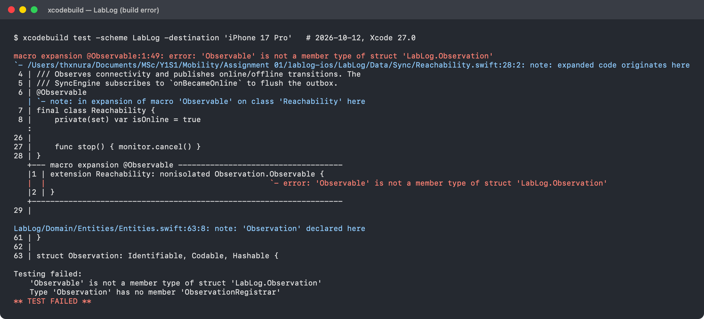 (made from the exact xcodebuild output). Full compiler output: [`screenshots/001-observation-shadows-module.log`](screenshots/001-observation-shadows-module.log).
**Cause:** The `@Observable` macro (used by `Reachability` and `SyncEngine`) expands to fully-qualified names like `Observation.Observable` and `Observation.ObservationRegistrar`. Our domain entity was also called `Observation`, so inside the `LabLog` module the name resolved to our struct instead of Apple's `Observation` module, and the macro output stopped compiling.
**Fix:** Renamed the domain entity to `LabObservation` (`Entities.swift`, `LocalStore.addObservation`). The wire DTO (`SyncObservationDTO`) and the backend's `observations` JSON key are unchanged. Lesson: don't give domain types the same name as a system module (`Observation`, `Foundation`, `Network`, …).
**AI prompt used (if any):**
    > check the status of this project and install the app in my iphone
**AI result:** worked — Claude Code found the cause from the compiler notes and proposed the rename; rebuild passed (3/3 `StepConstraintEngineTests` green).

### Failure 002
**SwiftData ModelContainer freed while its context was in use (test host crash loop)** · 12 Oct 2026

**Type:** runtime crash
**What I was doing:** First run of the new `SwiftDataStoreTests` / `SyncEngineTests` (in-memory SwiftData).
**Error / output:**
    Exception Type:  EXC_BREAKPOINT (SIGTRAP)
    3  LabLog.debug.dylib  SwiftDataStore.hasCatalog()  (SwiftDataStore.swift:32)
    5  LabLog.debug.dylib  static CatalogSeed.installIfNeeded(into:)  (CatalogSeed.swift:101)
    6  LabLogTests         SwiftDataStoreTests.setUp()  (SwiftDataStoreTests.swift:12)
    Restarting after unexpected exit, crash, or test timeout; … (16 restarts)
On the Mac this showed up as a repeating "LabLog quit unexpectedly" dialog.
**Screenshot:** 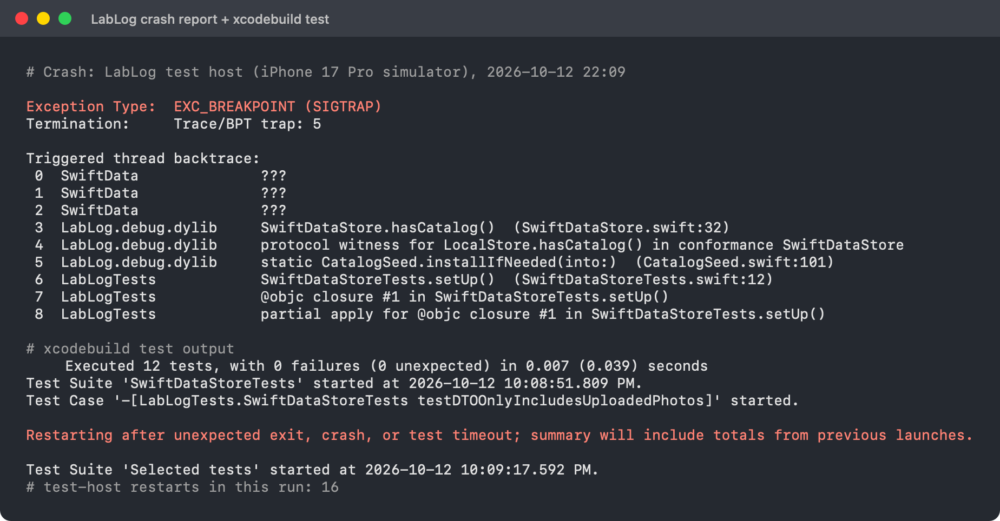 (from the crash report + xcodebuild output; raw: [`002-swiftdata-container-released.log`](screenshots/002-swiftdata-container-released.log)). The repeated macOS "LabLog quit unexpectedly" dialog that first showed the problem isn't in the repo.
**Cause:** `SwiftDataStore` kept only `container.mainContext`. A `ModelContext` doesn't retain its `ModelContainer`, so in the tests (where nothing else held it) the container was freed and the next fetch trapped. The app only escaped because `AppModel` happened to hold the container too.
**Fix:** The store now keeps a strong reference to the `ModelContainer`. Re-ran: 28/28 unit tests pass with no crash.
**AI prompt used:**
    > i get this error repetatively
**AI result:** worked. Claude read the `.ips` crash report, found the cause and applied a one-line ownership fix.

### Failure 003
**Badge text wrapped / disappeared; Sync "Network" row far too tall** · 12 Oct 2026

**Type:** logic (UI layout)
**What I was doing:** Reviewing the UI-test screenshots of the first full build.
**Error / output:** The "Pending" badge wrapped to "Pend-ing" in the Records list. The Network row on the Sync screen was about 4× the normal height. The first fix (`.fixedSize()` on the badge `Label`) made the word disappear, leaving only the icon.
**Screenshot:** before 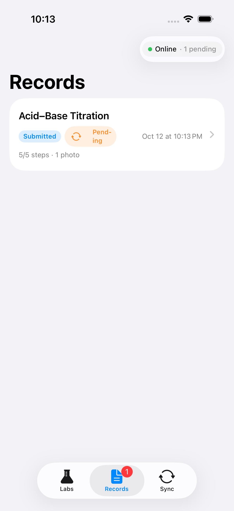 · attempt 2 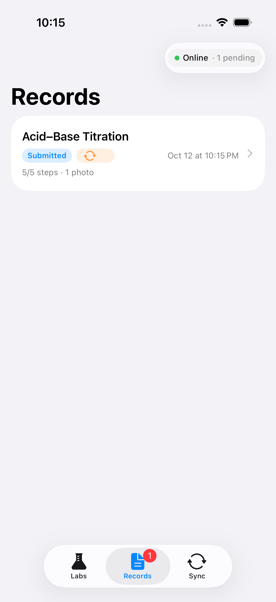 · after 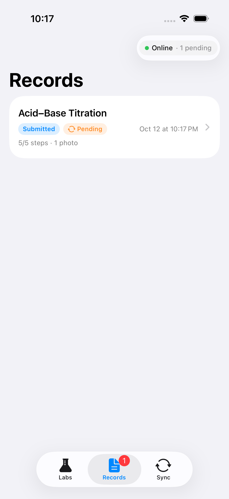 · Sync row before 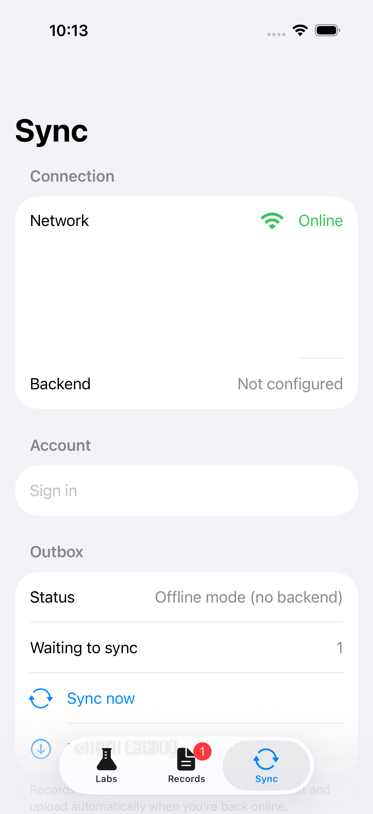 / after 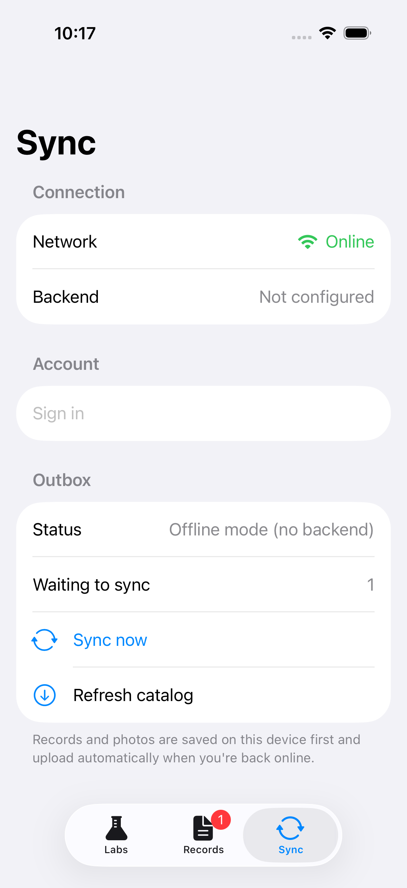
**Cause:** SwiftUI's automatic `Label` style adapts to its container. In a tight List row it collapsed to icon-only. Inside `LabeledContent` it laid out as a stacked title/subtitle pair.
**Fix:** Use an explicit `HStack { Image; Text }` with `.lineLimit(1).fixedSize()` for badges and the Network value.
**AI result:** partially. The first fix was wrong (icon only); the second worked.

### Failure 004
**UI test tapped the floating Submit bar instead of Step 4 (+ xcodebuild hang)** · 12 Oct 2026

**Type:** logic (UI test)
**What I was doing:** Running the UI tests after the visual redesign (ADR-013).
**Error / output:**
    LabLogFlowUITests.swift:56: error: -[LabLogUITests.LabLogFlowUITests testTitrationFlow] : XCTAssertTrue failed
    (waiting for the "toast" element after tapping step-4)
After the failure, `xcodebuild` stayed alive for more than 10 minutes and had to be killed, which also lost the automatic failure screenshot in the .xcresult.
**Screenshot:** 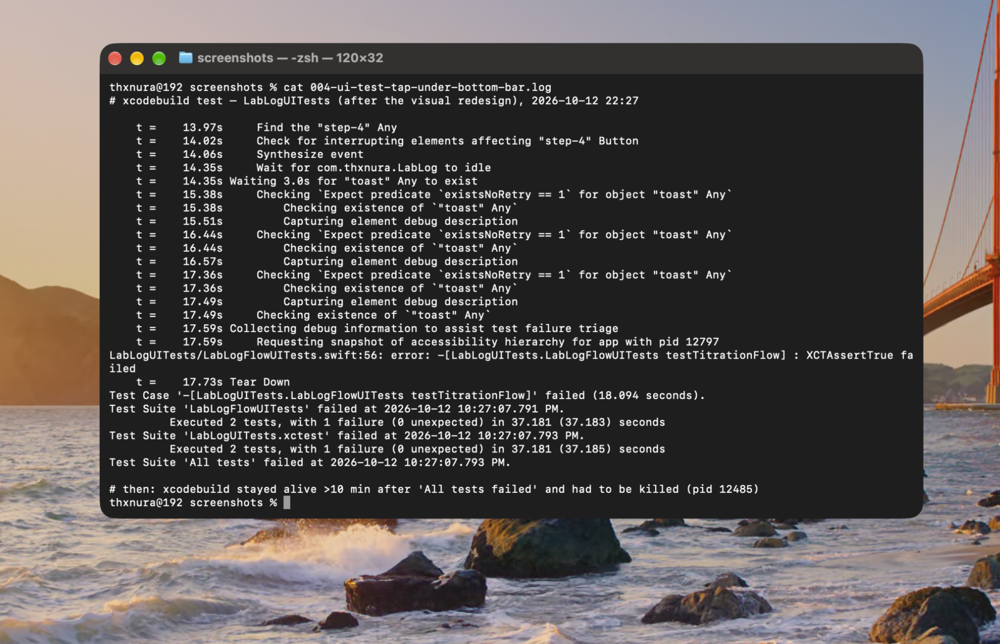 (raw: [`004-ui-test-tap-under-bottom-bar.log`](screenshots/004-ui-test-tap-under-bottom-bar.log))
**Cause:** The redesign pins Submit to a floating bottom bar. Step 4's card sat partly under it, and XCUITest taps an element's centre, so the tap landed on the disabled Submit button. A real user would scroll first, so this is a test bug, not an app bug.
**Fix:** A `tapStep(_:)` helper scrolls each card into the clear band between the navigation bar and the bottom bar, then taps near the card's top.
**AI prompt used:**
    > its look too much basic, make ui ux more like other porffesional app design with apple design skills
**AI result:** partially. The redesign shipped, but it broke this test until the helper was added.

### Failure 005
**Container accessibilityIdentifier overrode every child's identifier** · 12 Oct 2026

**Type:** logic (UI test / accessibility)
**What I was doing:** Running the UI tests after adding the step guide sheet and the Live Activity timer.
**Error / output:**
    LabLogFlowUITests.swift:63: error: -[LabLogUITests.LabLogFlowUITests testTitrationFlow] : XCTAssertTrue failed
    LabLogFlowUITests.swift:176: error: -[LabLogUITests.LabLogFlowUITests testPendulumTimer] : XCTAssertTrue failed
    (debug description) Button …, identifier: 'step-guide', label: 'Close guide'
**Screenshot:** 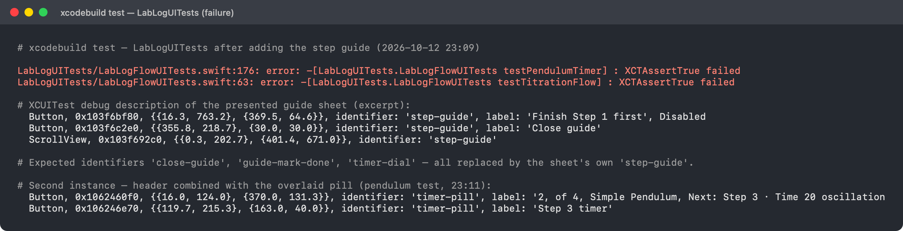 (raw: [`005-accessibility-id-overrides-children.log`](screenshots/005-accessibility-id-overrides-children.log))
**Cause:** The guide sheet *did* open. But I had put `.accessibilityIdentifier("step-guide")` on the sheet's root view, and SwiftUI pushes a container's identifier down onto its children, replacing their own (`close-guide`, `guide-mark-done`, `timer-dial`). The tests waited for ids that no longer existed.
**Second instance (same run, pendulum test):** the record header card had `.accessibilityElement(children: .combine)` applied *after* the floating timer pill was overlaid on it. That merged the pill into the header, so the whole header (`label: '2, of 4, Simple Pendulum…'`) carried the `timer-pill` identifier, and the test tapped the header's centre instead of the pill. This was also wrong for VoiceOver users, because the pill wasn't a separate button.
**Fix:** Removed the container-level identifiers (guide sheet, evidence section, submission receipt). Moved `.accessibilityElement(children: .combine)` before the pill overlay so the pill stays its own button. Re-ran: both UI tests pass. Lesson: only put identifiers on leaf elements, and combine accessibility children before overlaying controls.
**AI prompt used:**
    > add more interactibe animations like when timer goes show them in dynamic island and show interactive timer, and when we click step add step guide as well
**AI result:** partially. The feature built cleanly first time, but this mistake failed both UI tests until it was fixed.

### Failure 006
**Flaky timer UI test (tap during push; island press deep-linked)** · 12 Oct 2026

**Type:** logic (UI test)
**What I was doing:** Re-running `testPendulumTimer` to recapture screenshots.
**Error / output:** Run A: `Failed to tap "start-record" Any: No matches found`. Run B: `LabLogFlowUITests.swift:207: XCTAssertTrue failed` (waiting for `timer-pill` after returning to the app).
**Screenshot:** 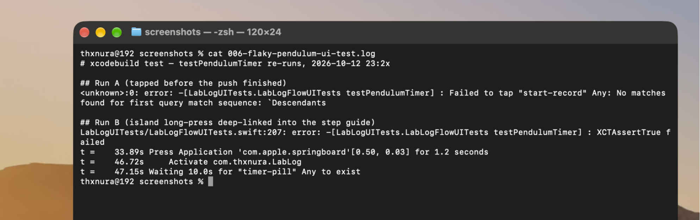 (raw: [`006-flaky-pendulum-ui-test.log`](screenshots/006-flaky-pendulum-ui-test.log))
**Cause:** A: the test tapped the experiment and then Start before the navigation push had finished. B: the long-press that expands the Dynamic Island also registered as a tap. That opened the app through the Live Activity's deep link, which opened the step guide over the timer pill. That part is correct app behaviour; the test didn't expect it.
**Fix:** Added `waitForExistence` before each tap in the flow, and the test now closes the guide if the island press opened it.
**AI result:** worked after both fixes.

### Failure 007
**Submit confirmation rendered as a popover pointing at a step card (UX)** · 12 Oct 2026

**Type:** logic (UI/UX)
**What I was doing:** Submitting a record on my iPhone (iOS 27.2, dark mode).
**Error / output:** The `.confirmationDialog("Submit this lab record?")` appeared as a floating popover near the top, with its arrow pointing at the Step 1 card. It looked broken, and it didn't show what was being submitted.
**Screenshot:** the popover was spotted on my iPhone; that screenshot wasn't kept in the repo. After the fix: 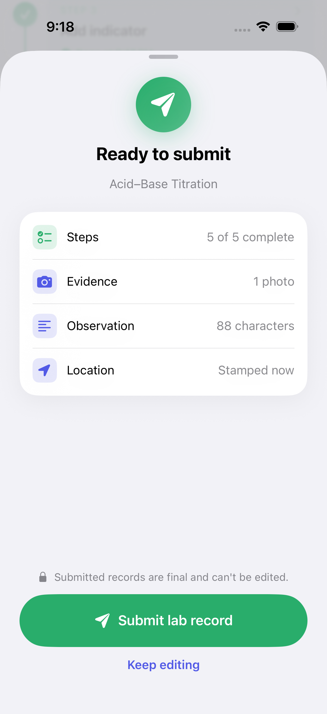 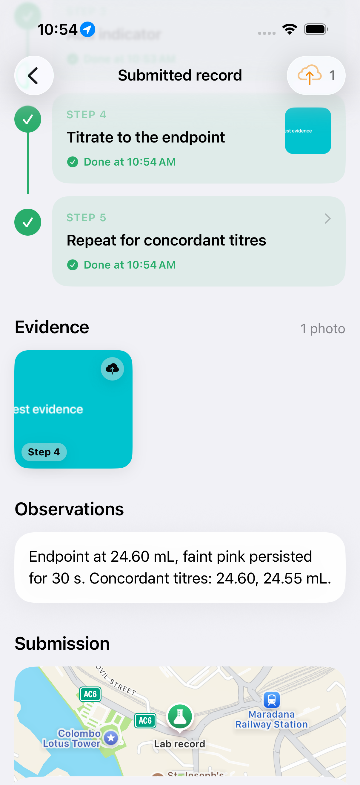
**Cause:** On recent iOS, a confirmation dialog attached to a large container is presented as a popover anchored to that view, not as an action sheet from the button.
**Fix:** Replaced it with `SubmitReviewSheet`: a summary of steps, photos, observation and location; a warning if there is no observation; one primary "Submit lab record" button and a "Keep editing" option; then an animated "Submitted" state that closes itself. (ADR-017)
**AI prompt used:**
    > this submit dialog look ugly, fix it, also make dynamic island more good with details and make proffesional
**AI result:** worked. Verified in UI-test screenshots.

### Failure 008
**Backend couldn't start: port 3000 already in use** · 14 Oct 2026

**Type:** runtime crash (backend)
**What I was doing:** Starting the Express API (`npm run dev`) to connect the app to a local Supabase stack for the first real end-to-end sync.
**Error / output:**
    Error: listen EADDRINUSE: address already in use :::3000
      code: 'EADDRINUSE', address: '::', port: 3000
    $ curl http://192.168.1.8:3000/api/health  →  thxnura.labs Next.js 404 page
**Screenshot:** 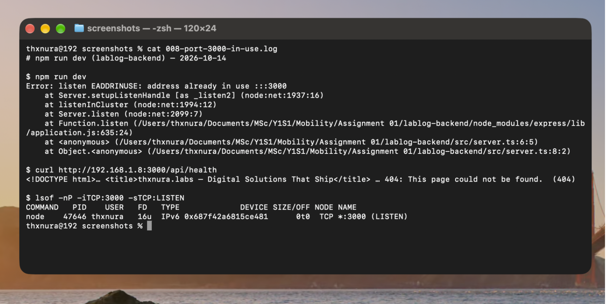 (raw: [`008-port-3000-in-use.log`](screenshots/008-port-3000-in-use.log))
**Cause:** Port 3000 (the default in `.env.example`) was already taken on my Mac by another project's Next.js dev server. The health check reached that site instead of LabLog.
**Fix:** The local setup script now writes `PORT=3100` by default (configurable with `--port`) and generates the matching iOS `Secrets.xcconfig`. I didn't touch the other server.
**AI prompt used:**
    > yes continue and do next build
**AI result:** worked.

### Failure 009
**Flaky sign-in UI test (three different failures)** · 14 Oct 2026

**Type:** logic (UI test)
**What I was doing:** Adding `testSignInAndSyncToServer`, which signs in as the demo student and checks the outbox drains to the real backend.
**Error / output:** Run 1: `LabLogFlowUITests.swift:227: XCTAssertTrue failed` (no sign-in button). Run 2: `Failed to tap "lab-PHYS101" … No matches found`. Run 3: `Failed to synthesize event: Neither element nor any descendant has keyboard focus`.
**Screenshot:** 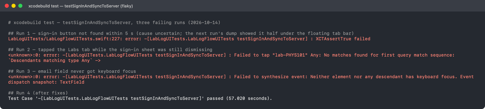 (raw: [`009-flaky-sign-in-ui-test.log`](screenshots/009-flaky-sign-in-ui-test.log))
**Cause:** Run 1 is uncertain; a hierarchy dump in the next run showed the button half under the floating tab bar. Run 2: the test tapped the Labs tab while the sign-in sheet was still dismissing. Run 3: tapping the email field during the sheet animation didn't give it keyboard focus.
**Fix:** In the app, the sign-in sheet now focuses the email field itself (a UX gain: the keyboard is up straight away). In the test: scroll the account card into view, wait for the sheet to settle and for the Labs list to appear, and print the screen hierarchy on failure, because `xcodebuild` keeps hanging after failures and losing the `.xcresult`. Run 4 passed, and the record, 2 steps and the photo were confirmed in Postgres and Storage.
**AI result:** partially. It took three attempts.

### Failure 010
**GPS stamp "Not available" in test runs; flaky submit UI test** · 14 Oct 2026

**Type:** logic (UI test / test environment)
**What I was doing:** Reviewing the report figures. The receipt from the last full UI run read "Location: Not available", although on 12 Oct the same flow produced coordinates and a map.
**Error / output:**
    Receipt: Location  Not available
    Run A: LabLogFlowUITests.swift:111: XCTAssertTrue failed            (no "start-record" after the tap)
    Run B: LabLogFlowUITests.swift:93: failed - submit-success not found  (yet the screen showed 'Submitted record' and 'Location, 6.9271, 79.8612')
**Screenshot:** 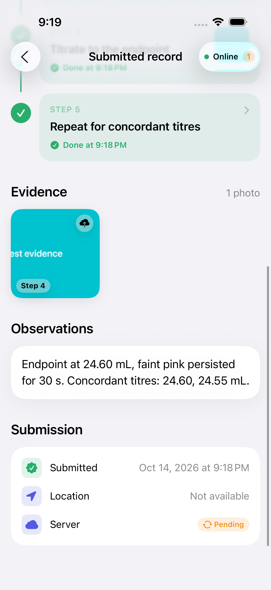 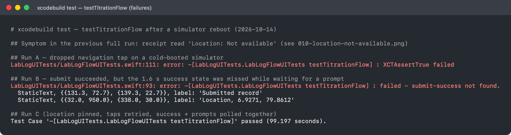 (raw: [`010-gps-reset-and-flaky-submit.log`](screenshots/010-gps-reset-and-flaky-submit.log))
**Cause:** Not an app bug. The simulator had been restarted since 12 Oct, so it no longer had a simulated location. The app did what it was designed to do: after a 10 s timeout, submit without a location. Once a location was set, two test bugs showed. A navigation tap on the cold-booted simulator was dropped. And because the GPS fix was now instant, the 1.6 s success screen came and went while the test was still waiting for a permission prompt.
**Fix:** The UI tests pin the location themselves (`XCUIDevice.shared.location`), retry a navigation tap once (`tap(_:expecting:)`), and watch for the success screen and any prompt in one polling loop. On failure, they print the app's and SpringBoard's screen trees. GPS verified: the receipt shows "6.9271, 79.8612" with the map.
**AI prompt used:**
    > ok do next ones
**AI result:** worked. Found while checking the report figures.

### Failure 011
**Flaky lecturer UI test: tab tap ignored, step tapped mid-layout** · 14 Oct 2026

**Type:** logic (UI test)
**What I was doing:** Adding `testLecturerReview`: the student submits, it syncs, and the lecturer reviews it in the new Review tab.
**Error / output:**
    Run A: failed - No sign-in button  (dump: still on the Labs tab although "Sync" was tapped at 6.31 s)
    Run B: LabLogFlowUITests.swift:343: XCTAssertTrue failed  (no confirm sheet: Step 5 never completed, so Submit stayed disabled)
**Screenshot:** 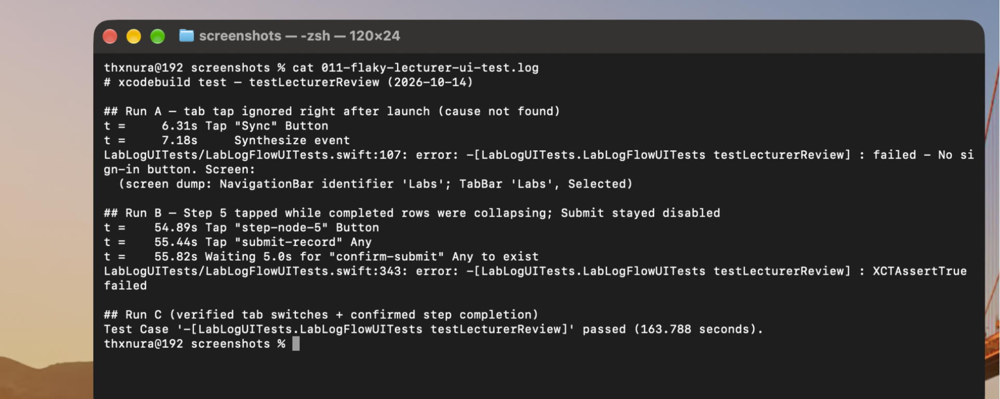 (raw: [`011-flaky-lecturer-ui-test.log`](screenshots/011-flaky-lecturer-ui-test.log))
**Cause:** A: the tab tap was sent but ignored right after launch. I didn't find the root cause; the same first step passed in the previous run. B: completed steps collapse and the list re-lays out, so the next circle tap landed while rows were still moving.
**Fix:** `selectTab(_:)` checks the navigation title and retries once. `completeStep(_:)` taps a circle, then waits until it reads "Step N done" (retrying once). Run C passed.
**AI prompt used:**
    > ok do next ones
**AI result:** partially. The lecturer view worked first time; the test needed two hardening rounds.

### Failure 012
**Retake button hidden under the step guide's floating Next button** · 16 Oct 2026

**Type:** logic (UI) — caught by the new UI test
**What I was doing:** Adding photo retake/remove, step notes, discard draft and a server-address setting. The new UI test `testEditingADraftAndServerAddress` completes Step 4 with a photo, then retakes it from the step guide.
**Error / output:**
    t =    53.64s     Synthesize event            (tap on "guide-retake-photo")
    t =    55.83s Waiting 5.0s for "step-note" Any to exist
    LabLogFlowUITests.swift:295: error: -[LabLogUITests.LabLogFlowUITests testEditingADraftAndServerAddress] : XCTAssertTrue failed
    # UI hierarchy at the failure: identifier: 'guide-mark-done', label: 'Mark step done'   ← Step 5's guide
**Screenshot:** 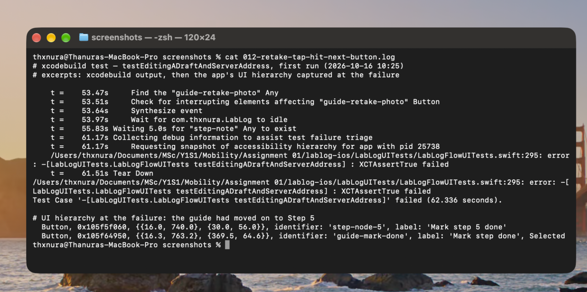 (log: `012-retake-tap-hit-next-button.log`)
**Cause:** The Retake/Remove buttons sat below a 190 pt photo, past the fold of the sheet and directly under the floating "Next: Step 5" button. XCUITest tapped the element's coordinates, the tap went to Next, and the guide moved to Step 5, which has no note field. This is the same class of bug as failure 004. It was also a real UX problem: a student wouldn't see Retake without scrolling.
**Fix:** Retake and Remove now float on the photo itself (material capsule and circle), so they are always on screen with the photo. The test asserts Retake is hittable and that the guide stays on Step 4 after the retake.
**AI prompt used:** (part of the "ok do next" build, see below)
**AI result:** partially. The first version of the evidence card had the hidden buttons; fixed after the UI test caught it.

### Failure 013
**TermShot captured keys I was typing (tooling)** · 16 Oct 2026

**Type:** tooling (TermShot, outside the app)
**What happened:** While I was typing elsewhere, TermShot brought its Terminal window to the front. My keys ("ow" + Return) went into its live shell, and the capture showed `zsh: command not found: ow` plus a Terminal mark. A live shell taking stray keystrokes could also run a command. The first fix froze the prompt with a script. That broke the title (it showed the script's path instead of `-zsh`, and the folder icon disappeared), and macOS also refused to give Terminal the focus while I was busy in another app.
**Screenshot:** none kept. Both faulty captures were overwritten by the retakes before I saved copies; this entry describes them instead.
**Fix:** In capture mode the window ends in a real interactive `-zsh` that sources my own startup files and then switches to an empty keymap, so every key does nothing. The prompt, cursor, title and folder icon stay genuine. TermShot waits until the keyboard and mouse have been idle for 1.5 s before taking the focus. If a key is pressed during the capture anyway, it throws the shot away and retakes it.
**AI result:** worked after two attempts. I asked for real screenshots; Claude Code noticed the typed text in the capture and fixed TermShot before re-taking 012.

### Failure 014
**Discard confirmation: "Multiple matching elements found"** · 16 Oct 2026

**Type:** UI test
**What I was doing:** The second run of `testEditingADraftAndServerAddress`, after the 012 fix. Retake and the step note passed; the test then confirmed "Discard this draft?".
**Error / output:**
    t =    75.21s Tap "Discard" Button
    <unknown>:0: error: -[LabLogUITests.LabLogFlowUITests testEditingADraftAndServerAddress] : Failed to tap "Discard" Button: Find single matching element. Multiple matching elements found for <XCUIElementQuery: …>.
**Screenshot:** 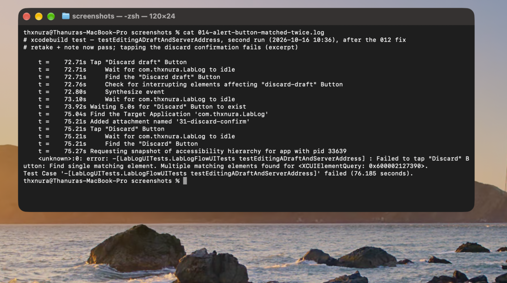 (log: `014-alert-button-matched-twice.log`)
**Cause:** The alert itself rendered correctly (one Discard button, see the test's `31-discard-confirm` screenshot). iOS 26 exposes an alert's button to XCUITest twice, so `app.alerts.buttons["Discard"]` matched two elements and refused to tap either.
**Fix:** The test takes the first match inside the first alert: `app.alerts.firstMatch.buttons.matching(identifier: "Discard").firstMatch`.

### Failure 015
**The Mac's IP changed mid-session; both sign-in UI tests failed** · 16 Oct 2026

**Type:** network — the risk ADR-021 addresses, happening for real
**What I was doing:** Running the full suite after adding the new features.
**Error / output:**
    LabLogFlowUITests.swift:146: error: -[LabLogUITests.LabLogFlowUITests testLecturerReview] : XCTAssertTrue failed - sign-in against Supabase Auth
    LabLogFlowUITests.swift:146: error: -[LabLogUITests.LabLogFlowUITests testSignInAndSyncToServer] : XCTAssertTrue failed - sign-in against Supabase Auth
    $ ipconfig getifaddr en0                                               → 192.168.1.88
    $ curl … http://192.168.1.8:54321/auth/v1/health                        → 000 (unreachable)
    $ curl … http://192.168.1.88:54321/auth/v1/health                       → 200
**Screenshot:** 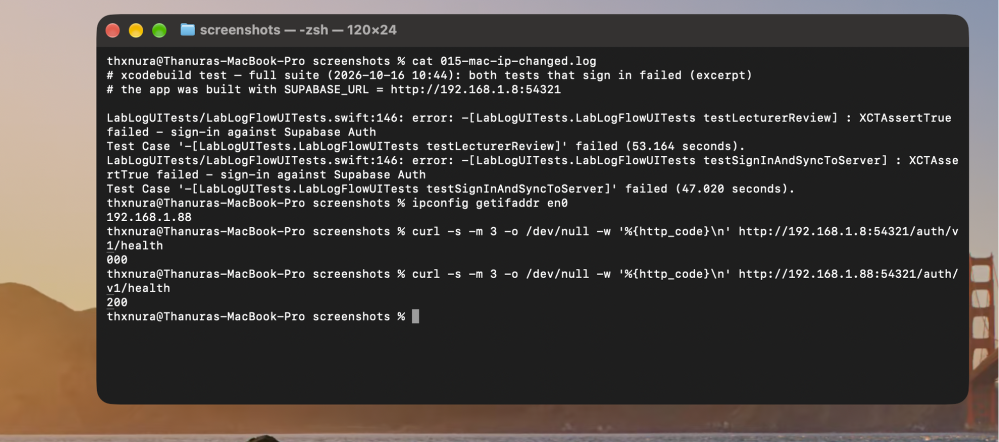 (log: `015-mac-ip-changed.log`; the `ipconfig` and `curl` lines were run live in that Terminal window)
**Cause:** The router gave the Mac a new address (192.168.1.8 → 192.168.1.88) during the session. The app is built with the old address, so sign-in couldn't reach Supabase. No code was wrong. Before ADR-021 this would have needed a rebuild, and during a demo it would have broken sync.
**Fix:** UI tests now launch with `-LabLogServerHost 127.0.0.1` (the simulator always reaches the Mac there), so they no longer depend on the Wi-Fi address. On a phone, Sync → Server takes the new address without a rebuild. The build's default in `Secrets.xcconfig` is now 192.168.1.88. The same full run also showed the draft test tapping Step 4 mid-layout, so it now waits for "Step 4 done", as `completeStep` does (cf. 011).

### Failure 016
**Full suite: titration and sign-in UI tests flaked** · 16 Oct 2026

**Type:** UI test timing (no app change needed)
**What I was doing:** The second full run after the 015 fix. 47 unit tests and 3 UI tests passed, including the new one and the lecturer test.
**Error / output:**
    t = 52.84s Tap "step-node-5" Button … t = 61.68s Tap "submit-record" Any
    LabLogFlowUITests.swift:237: error: -[LabLogUITests.LabLogFlowUITests testTitrationFlow] : XCTAssertTrue failed
    # hierarchy: 'submit-record' … Disabled   ← a step tapped mid-layout never completed
    t = 26.24s Tap "sign-in" Button → Waiting 5.0s for "email"
    LabLogFlowUITests.swift:140: error: -[LabLogUITests.LabLogFlowUITests testSignInAndSyncToServer] : XCTAssertTrue failed
    # hierarchy: still the Sync screen, no sign-in sheet   ← the tap was dropped
**Screenshot:** 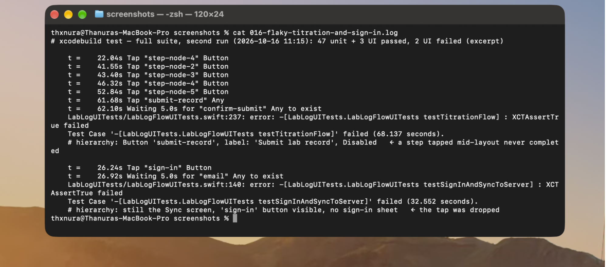 (log: `016-flaky-titration-and-sign-in.log`)
**Cause:** The titration test was the last one still tapping step circles without confirming them. With the evidence section now above the observation, the re-layout after the photo made a tap land mid-animation (same class as 011). The sign-in tap was dropped once. The lecturer test passed through the same sign-in helper in this very run.
**Fix:** The titration test uses `completeStep` (tap, then wait for "Step N done") for every step. The sign-in helper uses `tap(_:expecting:)`, which retries a dropped tap once.

### Failure 017
**UI tests failed in a different place each run while the Mac was overloaded** · 18 Oct 2026

**Type:** UI test timing under load (no app change needed)
**What I was doing:** Running the full suite after replacing the "Online" pill with the sync icon (ADR-024). All 51 unit tests passed every time.
**Error / output:**
    LabLogFlowUITests.swift:109: error: -[LabLogUITests.LabLogFlowUITests testSignInAndSyncToServer] : failed - step-1 not found.
    LabLogFlowUITests.swift:83: error: -[LabLogUITests.LabLogFlowUITests testTitrationFlow] : XCTAssertTrue failed
    # rerun: sign-in passed, titration failed somewhere else
    LabLogFlowUITests.swift:109: error: -[LabLogUITests.LabLogFlowUITests testTitrationFlow] : failed - start-record not found.
    # titration alone: passed in 152 s (usually ~90 s), then failed again
    <unknown>:0: error: -[LabLogUITests.LabLogFlowUITests testTitrationFlow] : Failed to synthesize event: Neither element nor any descendant has keyboard focus. Event dispatch snapshot: TextField, … identifier: 'observation'
    Load Avg: 10.54, 17.98, 27.88        LabLog %CPU while idle: 0.0 0.0 0.0 0.0 0.0
**Screenshot:** 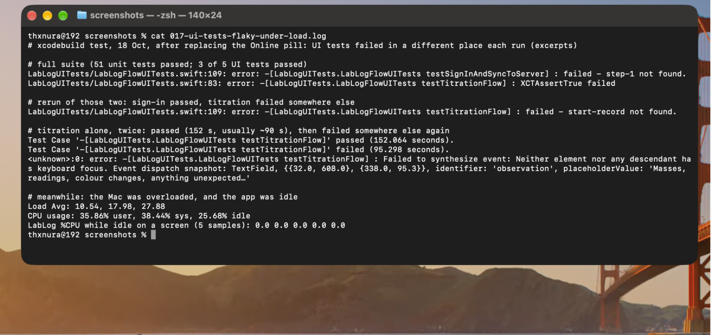 (log: `017-ui-tests-flaky-under-load.log`)
**Cause:** Each run failed at a different step, and each failure was a tap or a focus that never arrived: the next screen didn't open, or the text field had no keyboard when the test typed. The Mac's load average was near 28 at the time (other work was running), and a test that normally takes about 90 seconds took 152. The app itself was idle at 0% CPU, so it was not busy or stuck; the simulator was slow to deliver events. The new indicator was not involved: none of the failures touched the toolbar.
**Fix:** The test helpers now confirm every tap and focus and retry: `tap(_:expecting:)` retries up to twice, `openGuide` re-taps when the guide doesn't open, and a new `focus(_:)` waits for the keyboard before typing (the observation and step-note fields). The next full run passed: 51 unit tests and 5 UI tests. The app code was not changed for this. The dark-mode rerun then hit one more dropped tap of the same kind (*Mark step done* in the step guide, `LabLogFlowUITests.swift:223`) while the backend tests ran alongside; that tap now goes through `tap(_:expecting:)` too, and the rerun passed. The last full run of the day hit one more: the lecturer test's tap on the newest submission, made just as the list finished loading, didn't open it (`failed - submission detail not found`, the list still on screen ten seconds later). That tap now retries too 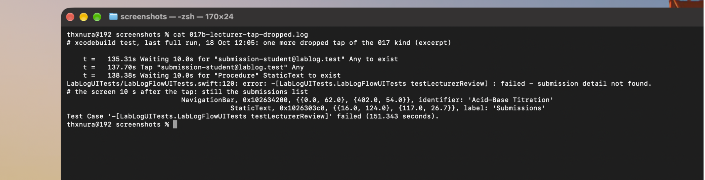 (log: `017b-lecturer-tap-dropped.log`). One more in the run after that: the server-address field was typed into before it had focus (`Failed to synthesize event: Neither element nor any descendant has keyboard focus`); it now goes through `focus(_:)` like the other fields 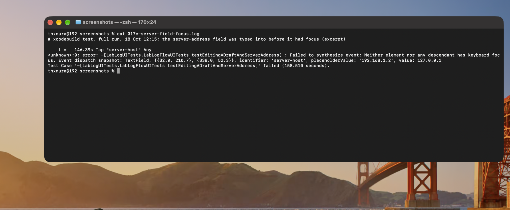 (log: `017c-server-field-focus.log`). And one in the pendulum test after the hosted-build change, which didn't touch that screen: the tap on the timer pill didn't open the step guide, and the pill was still on the checklist (`LabLogFlowUITests.swift:388`). That tap now retries too 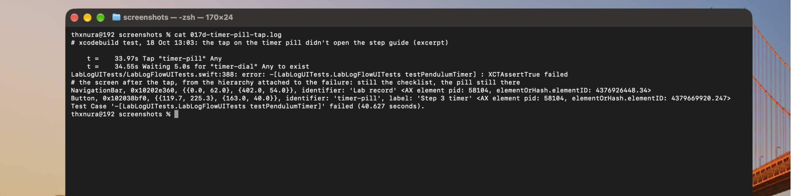 (log: `017d-timer-pill-tap.log`). And one at the end of the lecturer test, rerun for fresh report screenshots: the tap on **Sign Out** didn't register, and ten seconds later the app was still on Sync (`XCTAssertTrue failed - back on the sign-in screen`, `LabLogFlowUITests.swift:172`; sign-out has no network call, so nothing was waiting). The helper now taps again when neither the confirmation nor the sign-in screen appears, and the rerun passed 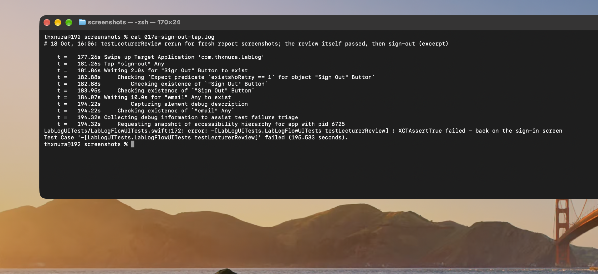 (log: `017e-sign-out-tap.log`).

### Failure 018
**Since 16 Oct the server deleted every new photo right after it was uploaded** · 18 Oct 2026

**Type:** data loss in sync (backend). Found by reviewing screenshots, not by a failing test
**What I was doing:** Rebuilding the report figures after the full run. The lecturer's submission screen showed **0 Photos** for a titration record, whose Step 4 can't be completed without a photo.
**Error / output:**
    $ psql … (photos per record, newest first)
     79be2925-… | submitted | 2026-10-18 05:18:58+00 | … |      0     ← every record since 16 Oct
     94881176-… | submitted | 2026-10-14 16:59:08+00 | … |      1     ← records from 14 Oct still have theirs
    $ docker logs … supabase_storage_lablog-backend
    2026-10-18T05:22:36.014Z PUT /object/upload/sign/evidence/records/59ab1c65-…/439fcb6c-….jpg?token=redacted 200
    2026-10-18T05:22:36.185Z DELETE /object/evidence 200      ← 171 ms after the upload
    $ npm run test:e2e   (a new test that sends ids in upper case, as the app does)
    ✖ upper-case ids, as the iOS app sends them, keep their photo
      + actual - expected
      + []
      - [ 'ae7580fa-32a8-46da-9d15-f379f4a72fde' ]
**Screenshot:** 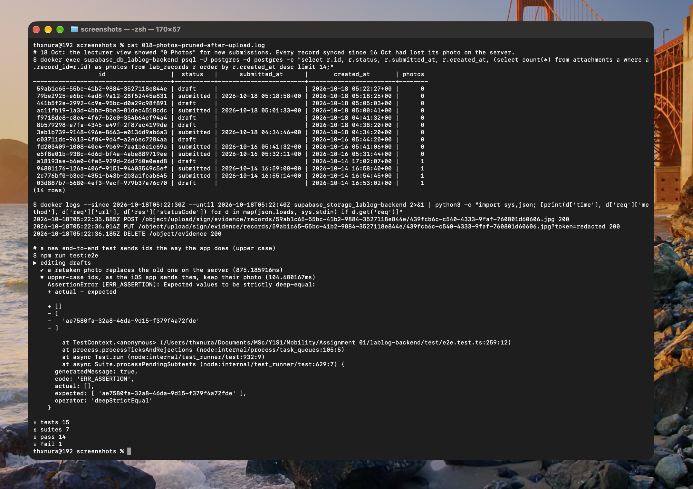 (log: `018-photos-pruned-after-upload.log`)
**Cause:** ADR-023 (16 Oct) made the sync payload carry a record's full photo set and the API delete any photo missing from it. The API checked this in code with `keepIds.includes(a.id)`. Swift's `JSONEncoder` writes UUIDs in upper case, but Postgres returns them in lower case, so the photo the app had just sent never matched and was deleted with its file. The backend tests generate lower-case ids, so they passed; the UI tests only waited for "Everything is synced", which was true. Records from 14 Oct were unaffected because they were synced before the prune existed.
**Fix:** The API now lower-cases every id when it validates a request (`uuid()` in `src/dto/sync.dto.ts`), before any code compares ids. A new end-to-end test sends upper-case ids and checks that the photo row and file survive: it failed before the fix and passes after (15 of 15). Checked through the app as well: the next lecturer UI test's record has its photo in Postgres and in Storage. Photos lost between 16 and 18 Oct were test data on my Mac.

### Failure 019
**"Start lab record" sometimes opened an empty "Submitted record" screen** · 18 Oct 2026

**Type:** app bug (a SwiftUI race), found by the final full test run
**What I was doing:** The last full run before submitting, after the fixes above.
**Error / output:**
    t =    20.85s Tap "start-record" Any
    t =    22.25s Waiting 6.0s for "step-1" Any to exist
    LabLogFlowUITests.swift:120: error: -[LabLogUITests.LabLogFlowUITests testEditingADraftAndServerAddress] : failed - step-1 not found.
    # the screen at that moment:
    NavigationBar … identifier: 'Submitted record'
    StaticText … label: '0, of 0'
    StaticText … label: 'No observation recorded.'
**Screenshot:** 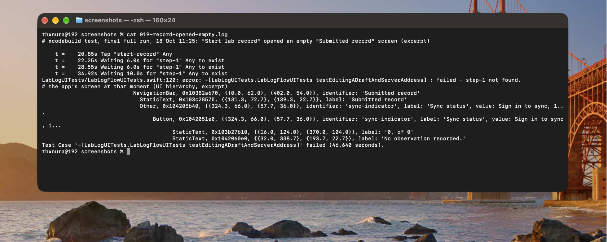 (log: `019-record-opened-empty.log`)
**Cause:** `RecordCaptureView` had two tasks: one created its model, the other loaded it (and reloaded whenever the store changed). SwiftUI doesn't promise which starts first. When the load ran first, the model didn't exist yet, so nothing loaded; with no later store change, the screen kept an empty model. An empty model has no record, so it isn't a draft: the title said "Submitted record", with 0 of 0 steps and no way to work. The same test had passed four times today, so it happens rarely, but a student would have seen it.
**Fix:** One task creates the model and loads it, and runs again when the store changes. The next full run passed.

### Failure 020
**The sync popover said "Sign in to sync" but had no way to sign in** · 18 Oct 2026

**Type:** UX, reported from my iPhone (like 007)
**What I was doing:** Using the new build on my phone, signed out, with 9 records waiting. I tapped the sync icon, then tapped the popover expecting to sign in.
**Error / output:** No error: the popover only said "9 records are saved on this iPhone. Sign in from the Sync tab to upload." Tapping it did nothing.
**Screenshot:** 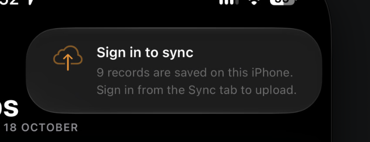 (my iPhone)
**Cause:** ADR-024 gave the popover one action, *Sync now*, and only for "waiting" and "failed". Signing in was left to the Sync tab, so the one state that needs an action had none.
**Fix:** The indicator state now names its action (`action`: `.syncNow` or `.signIn`). Signed out, the popover shows **Sign in**, which closes the popover and opens the sign-in sheet in place; the sheet is presented once the popover has gone, because UIKit won't start a second presentation while the first is dismissing. A unit test checks the action for each state, and the editing UI test now taps **Sign in** in the popover and waits for the email field.

That new test step failed first: `XCTAssertTrue failed - sign-in-popover not found`, although the button was on screen. The hierarchy attached to the failure showed every element in the popover, the button included, carrying the container's identifier `sync-status-details`: the same trap as failure 005, in code written two days later. The container now uses `.accessibilityElement(children: .contain)`, so the children keep their own identifiers, and the step passes. The same run caught "1 record … Sign in to upload them"; it now says "it" for one record. Evidence for this part: 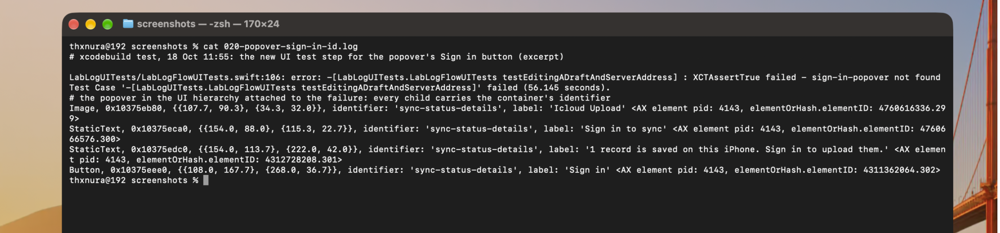 (log: `020-popover-sign-in-id.log`).

### Failure 021
**Sign-in on my iPhone hung, then timed out: the Mac's IP had changed again** · 18 Oct 2026

**Type:** network (the 015 risk again, this time on the phone), plus a UX gap
**What I was doing:** Signing in from the sync popover on my iPhone to upload 9 waiting records.
**Error / output:** The sign-in button spun for about 20 seconds, then the sheet showed a request timeout.
    $ ipconfig getifaddr en0
    192.168.1.2
    $ curl … http://192.168.1.88:54321/auth/v1/health   → 000 4.007411s
    $ curl … http://192.168.1.2:54321/auth/v1/health    → 200 0.047226s
**Screenshot:** 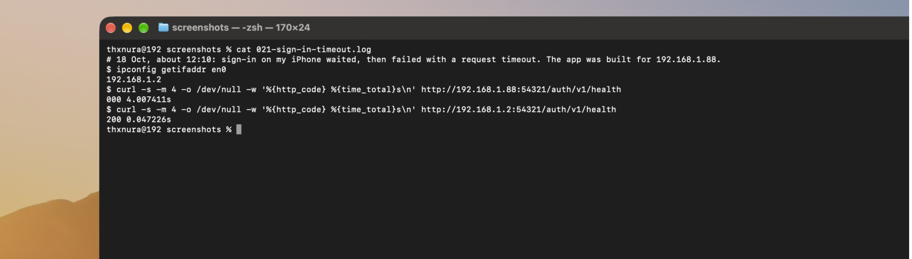 (log: `021-sign-in-timeout.log`)
**Cause:** The router gave the Mac a new address again (192.168.1.88 → 192.168.1.2). The phone's build pointed at .88, where nothing answers, so the sign-in request waited for its full 20-second timeout. The error then said only that the request timed out, which doesn't tell a student what to do; the fix (Sync → Server) was on another tab.
**Fix:** Sign-in now gives up after 8 seconds (a server on the same Wi-Fi answers in well under one). When nothing answers, it says "Can't reach the server at 192.168.1.88. If your Mac's address has changed, update it below." and shows **Change server address**, which opens the Server sheet on top of sign-in. A unit test signs in against an address where nothing listens and checks that message. The build default is now 192.168.1.2, and the new build is on my iPhone. The lasting fix is a hosted backend, which doesn't depend on the Mac's address.

### Failure 022
**A UI test started signed in: a session left in the Keychain by a test that failed** · 18 Oct 2026

**Type:** test isolation
**What I was doing:** The full run after 017b.
**Error / output:**
    LabLogFlowUITests.swift:106: error: -[LabLogUITests.LabLogFlowUITests testEditingADraftAndServerAddress] : XCTAssertTrue failed - sign-in-popover not found
    # the popover: 'Everything is synced', 'Your records and photos are on the server.', 'Last synced 3 seconds ago'
**Screenshot:** 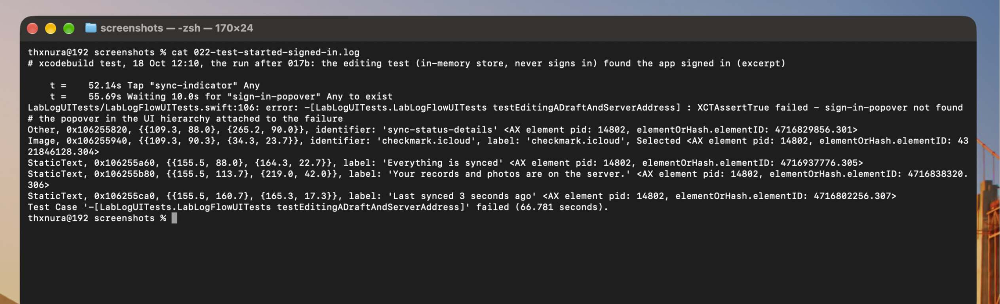 (log: `022-test-started-signed-in.log`)
**Cause:** The editing test never signs in, yet the app was signed in and fully synced. In the previous run the lecturer test had failed (017b) before its last line, which signs out, so the lecturer's session stayed in the simulator's Keychain. UI tests start with an empty in-memory store, but the Keychain outlives the app.
**Fix:** A UI-test launch (in-memory store) now also signs out, as it already clears timers and notifications. Tests that need an account sign in themselves.

### Failure 023
**Lecturer UI test: "Server returned 500: The connection to the database timed out"** · 18 Oct 2026

**Type:** environment (the local stack under load); no code change
**What I was doing:** The full run after the 022 fix.
**Error / output:**
    LabLogFlowUITests.swift:120: error: -[LabLogUITests.LabLogFlowUITests testLecturerReview] : failed - submission-student@lablog.test not found.
    # the screen: 'Couldn't load submissions' / 'Server returned 500: The connection to the database timed out'
    Load Avg: 11.44, 11.84, 10.40
**Screenshot:** 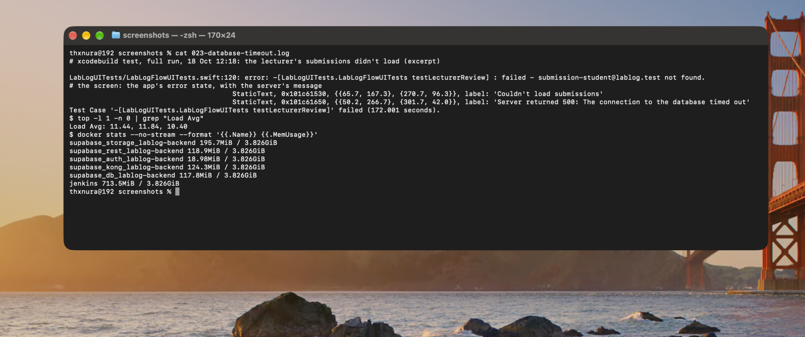 (log: `023-database-timeout.log`)
**Cause:** The lecturer's submissions request reached the API, but the local database didn't answer in time. Docker's VM (3.8 GB) was shared with another project's container (`jenkins`, 714 MB), the Mac's load average was about 11, and a device build had just run. A minute later every service answered in milliseconds. The app did the right thing: it showed "Couldn't load submissions" with the server's message instead of an empty list.
**Fix:** None in the code. The test passed on the rerun. It is one more reason for a hosted backend (§11).

### Failure 024
**After signing out, the previous student's records were still on the phone** · 18 Oct 2026

**Type:** privacy / data ownership, reported from my iPhone
**What I was doing:** Switching from the student to the lecturer on my phone, with the hosted build.
**Error / output:** No error. After **Sign out**, the Labs and Records tabs still showed the student's records and photos ("it show offline data").
**Screenshot:** none; reported in words. The fix is checked by the sign-in UI test (Records shows "No lab records" after signing out).
**Cause:** Records are stored on the phone first and were never tied to an account there, so signing out only removed the session. Worse, a record that hadn't uploaded yet would have been uploaded by the next person to sign in, under their account.
**Fix:** Signing out now clears the phone's records, notes, observations and photos, and ends timers and notifications; the catalog stays and the server keeps what synced (ADR-026). If anything is still waiting to upload, an alert warns that it will be lost. An open record screen closes itself when its record disappears. A store unit test covers the clearing.

### Failure 025
**Every UI and backend test failed at once: Docker Desktop had stopped** · 18 Oct 2026

**Type:** environment; no code change
**What I was doing:** The full run after redesigning the sign-in screen.
**Error / output:**
    LabLogFlowUITests.swift:120: error: … : failed - signed in (sign-in against Supabase Auth) not found.   (all 5 UI tests)
    $ npm run test:e2e
      Error [AuthRetryableFetchError]: fetch failed
    $ docker ps
    failed to connect to the docker API at unix:///Users/thxnura/.docker/run/docker.sock; … is the daemon running
**Screenshot:** 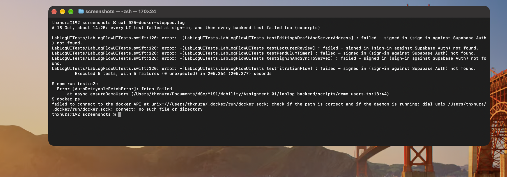 (log: `025-docker-stopped.log`)
**Cause:** Docker Desktop had quit, taking the local Supabase stack with it. Every UI test now signs in at launch (ADR-027), so all five stopped at the same line; the redesign was not involved (the unit tests passed).
**Fix:** Docker restarted (`open -a Docker`); the stack came back by itself and all 16 backend tests passed. Before a demo, check that Docker is running (the viva checklist says so).

### Failure 026
**After signing back in, my earlier submissions were missing from the phone** · 18 Oct 2026

**Type:** missing feature, reported from my iPhone
**What I was doing:** Signing out and back in as the student on my phone, then opening Records.
**Error / output:** No error: Records was empty, although the hosted server had all ten of my records (`GET /api/records/mine` later returned them: 9 submitted, 1 draft).
**Screenshot:** none; reported in words. The fix is checked by the sign-in UI test (sign out, sign back in, the record is listed again).
**Cause:** The app only ever pushed records. ADR-026 made sign-out clear the phone, so after signing back in there was nothing to show, and nothing brought the records back.
**Fix:** A new endpoint returns the student's own records with signed photo links, and the app restores the ones it lacks after every sync, downloading their photos; local records always win (ADR-028). Tests: one backend, two unit, one UI.

### Failure 027
**Three UI tests failed once records were restored after sign-in** · 18 Oct 2026

**Type:** test isolation
**What I was doing:** The first full run with ADR-028 in place.
**Error / output:**
    LabLogFlowUITests.swift:351: error: -[LabLogUITests.LabLogFlowUITests testEditingADraftAndServerAddress] : XCTAssertTrue failed
    LabLogFlowUITests.swift:120: error: -[LabLogUITests.LabLogFlowUITests testPendulumTimer] : failed - timer-dial not found.
    LabLogFlowUITests.swift:217: error: -[LabLogUITests.LabLogFlowUITests testTitrationFlow] : XCTAssertTrue failed
    # titration: Tap "step-node-4" → Waiting 3.0s for "toast": the step wasn't locked
**Screenshot:** 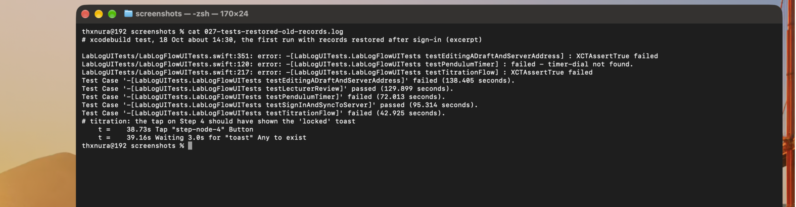 (log: `027-tests-restored-old-records.log`)
**Cause:** Every UI test signs in as the same local test student, who by now had dozens of records on the local server from earlier runs. After signing in, the app restored them (as it should), so "Start lab record" reopened an old draft with steps already done: Step 4 was no longer locked, and the pendulum's timer was already over. The sign-in and lecturer tests, which don't depend on a fresh record, passed.
**Fix:** A debug-only launch argument, `-UITestSkipRestore`, starts the flow tests from an empty phone; only the sign-in test, which checks the restore, leaves it off. The app's behaviour is unchanged.

### Failure 028
**A lecturer's timed first step never counted down, and the Dynamic Island didn't match** · 18 Oct 2026

**Type:** constraint-engine bug, reported from my iPhone
**What I was doing:** Doing a lab I had just created as a lecturer, whose step had a wait but no "unlocks after" step.
**Error / output:** No error: the step stayed on its full wait ("the counter is not going"), and the Dynamic Island didn't work.
**Screenshot:** none; reported in words. The fix is covered by two new unit tests.
**Cause:** The engine measures a wait from the latest prerequisite's completion, and fell back to *now* when there was none. Every check therefore restarted the wait, so it never ran down and the step could never be done. The seeded experiments always had a prerequisite before a timed step, so this only appeared once lecturers could write their own (ADR-029). The Live Activity used the same fallback: it started its countdown from the first check, while the app still said the step was locked.
**Fix:** A wait with no prerequisites now runs from when the record was started, which is when the step unlocked. The engine's context and the Live Activity's timed step both take the record's start time, and the checklist component gains a `startedAt` property for it. Unit tests: the engine counts 50 s, 1 s, then unlocks for a 60 s first step; the timed step for the Dynamic Island starts at the record's start.

### Failure 029
**Docker Desktop quit again: the lecturer test got 401 saving an experiment** · 18 Oct 2026

**Type:** environment
**Error / output:**
    LabLogFlowUITests.swift:506: error: … testLecturerCreatesALab : XCTAssertTrue failed - the experiment is in the lab
    # the editor said: 'Server returned 401: Invalid or expired token'
    $ docker ps   → failed to connect to the docker API … is the daemon running
    # 15:13: it quit a third time; the next run passed all 63 unit tests, then four UI tests failed
    LabLogFlowUITests.swift:123: error: … testPendulumTimer : failed - signed in (sign-in against Supabase Auth) not found.
    Docker's log: [ELECTRON] before-quit at 08:45, 09:34 and 09:43 UTC (14:15, 15:04 and 15:13 here)
    # 15:54: a fourth time, while rerunning the lecturer test for 030: the editor showed 'Server returned 401: Invalid or expired token' again
    [com.docker.backend.electron] electron pid 59999 requested backend shutdown
**Screenshot:** 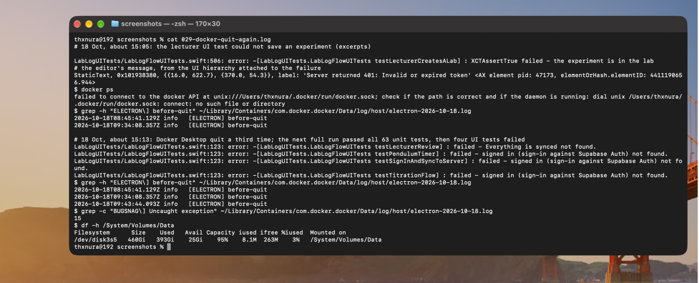 (log: `029-docker-quit-again.log`); the fourth quit, from the test's screen recording: 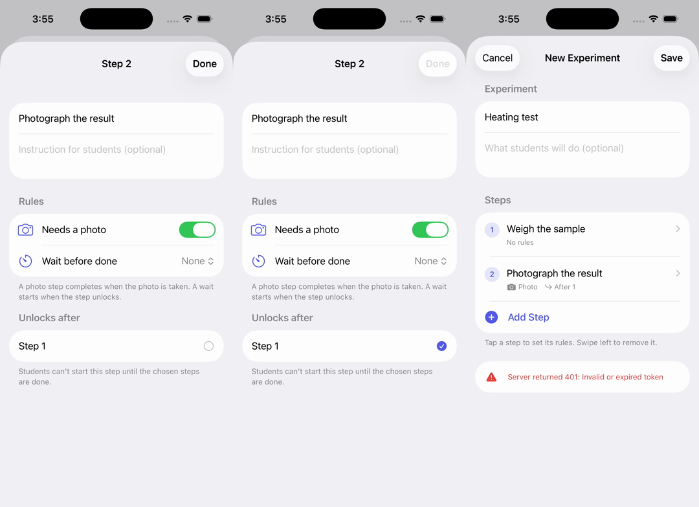
**Cause:** Docker Desktop quit a second, third and fourth time mid-run, taking the local Supabase Auth down. The API couldn't verify the token, so it answered 401; on the third quit, sign-in itself failed. Docker's own log shows an orderly quit each time (`before-quit`, then `will-quit`, then the app asking its backend to shut down), not a crash: something asked the app to quit; its 15 "Uncaught exception" entries all come during those shutdowns. Nothing in the app or API was wrong, and none of my commands quit it. The Mac's data volume is 95% full (25 GB free).
**Fix:** Restarted Docker each time; the next full run passed except one test-timing failure (030), and the 20 backend tests passed. The phone uses the hosted backend, which doesn't depend on Docker (ADR-025). Before the viva: check Docker is running before a local demo, and free some disk space.

### Failure 030
**The lecturer test checked an edited experiment before the save had finished** · 18 Oct 2026

**Type:** UI test timing (no app change)
**What I was doing:** The full run after the timer fix (028), with Docker running again.
**Error / output:**
    LabLogUITests/LabLogFlowUITests.swift:518: error: -[LabLogUITests.LabLogFlowUITests testLecturerCreatesALab] : XCTAssertTrue failed - the edit is saved
    Executed 6 tests, with 1 failure (0 unexpected) in 810.975 (811.005) seconds
**Screenshot:** 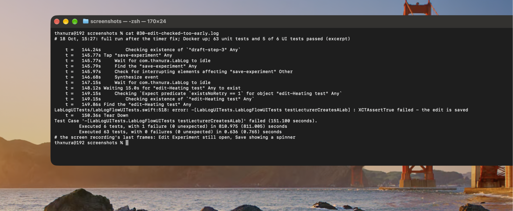 (log: `030-edit-checked-too-early.log`), and the last frames of the test's screen recording 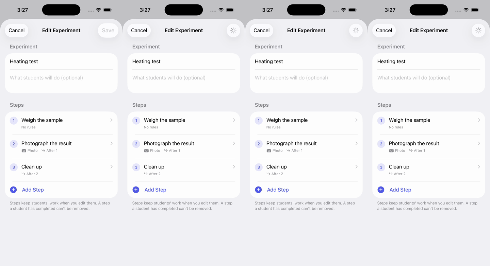
**Cause:** After tapping Save on the edited experiment, the test waited for the experiment's row to exist, then read its label for "3 steps". But the row already existed behind the sheet, so the wait ended at once and the label was read about three seconds after the tap. The screen recording shows the editor still open with Save spinning: the request to the local server hadn't answered yet. The same test passed in the previous run, when the save was quicker.
**Fix:** The test now waits up to 15 s for the row's label to contain "3 steps" instead of for the row to exist. The lecturer test passed on its own straight after, and the other five UI tests passed in the same full run. A final full run at 16:28, after 017e, passed all 63 unit tests and all 6 UI tests together, and the 20 backend tests passed.

### Failure 031
**The new hosted test script stopped at once: `read-only variable: status`** · 18 Oct 2026

**Type:** my own script (tooling)
**What I was doing:** The first run of `scripts/test-hosted.sh`, which runs the tests against the hosted backend (ADR-030).
**Error / output:**
    Test accounts ready: test.student@lablog.test (student), test.student2@lablog.test (student), test.lecturer@lablog.test (lecturer)
    Removed 0 test records, 0 photo files and 0 test labs.
    scripts/test-hosted.sh:30: read-only variable: status
**Screenshot:** 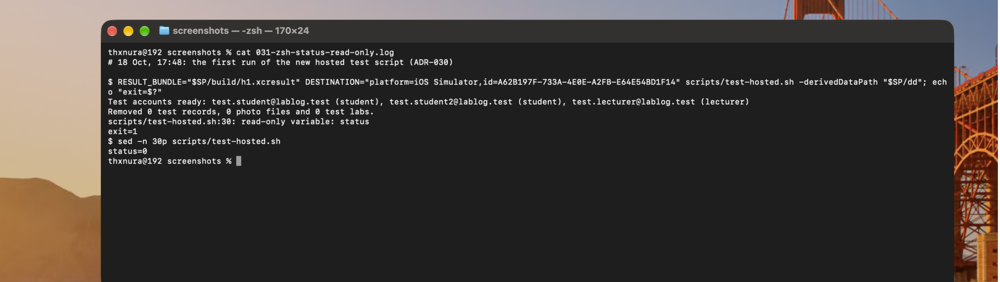 (log: `031-zsh-status-read-only.log`)
**Cause:** The script is a zsh script, and in zsh `status` is a built-in, read-only name for the last exit code (like `$?`). Assigning `status=0` stopped the script before `xcodebuild` ran.
**Fix:** The variable is now `result`. The next run passed all 63 unit tests and all 6 UI tests against the hosted backend, then removed the 3 records, 3 photo files and 1 lab the test accounts had created.

### Failure 032
**On my real iPhone, sign-in in the UI tests failed: the Passwords AutoFill bubble covered the password field** · 18 Oct 2026

**Type:** UI test on a physical device (no app change)
**What I was doing:** Running the UI tests on my iPhone 17 Pro for the first time (until now they ran on the simulator), against the hosted backend. All 63 unit tests passed on the phone.
**Error / output:**
    Tap "password" Any
    Type '<password>…' into "password"
    Failed: Neither element nor any descendant has keyboard focus. Event dispatch snapshot: SecureTextField, … identifier: 'password'
    LabLogFlowUITests.swift:169: error: -[LabLogUITests.LabLogFlowUITests testEditingADraftAndServerAddress] : Failed to synthesize event: Neither element nor any descendant has keyboard focus.
    # the hierarchy: the email field still "Keyboard Focused"; the same failure in testLecturerCreatesALab
**Screenshot:** 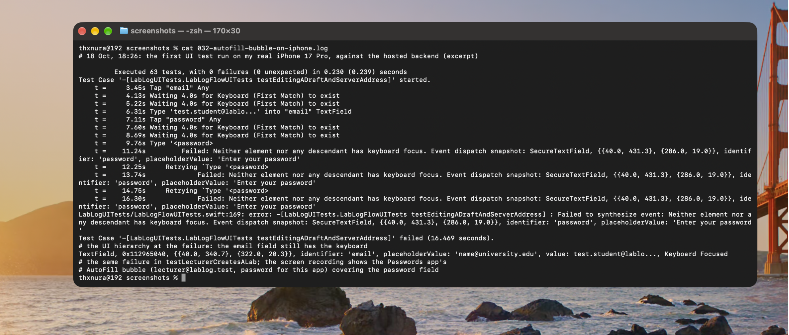 (log: `032-autofill-bubble-on-iphone.log`), and frames from the test's screen recording on the phone: 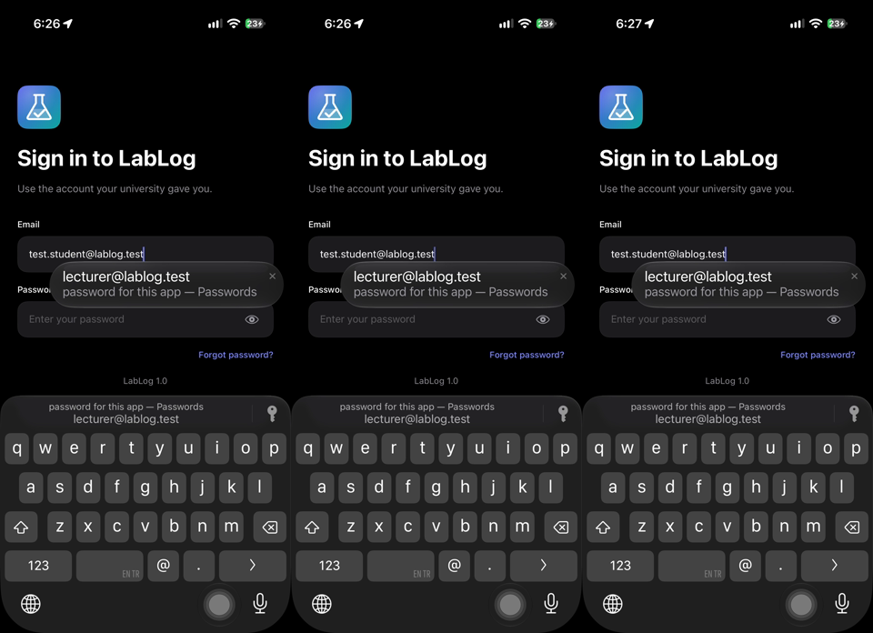
**Cause:** My phone has a LabLog password saved in the Passwords app, so iOS shows its AutoFill bubble ("lecturer@lablog.test, password for this app") right over the password field. The test's tap on the field landed on the bubble, so the keyboard stayed with the email field, and typing the password had nowhere to go. The simulator has no saved passwords, so this never happened there. The test helper only checked that *a* keyboard was showing, which it was: the email field's.
**Fix:** The test now presses Return after the email, which moves to the password field through the screen's own `onSubmit` (as a person would), and `focus(_:)` now waits for that specific field to have the keyboard (`hasKeyboardFocus`), tapping again only if it doesn't. The app needed no change: the bubble is iOS offering the saved password, and a person can tap it or dismiss it. I stopped the run after the second identical failure and re-ran it with the fix; sign-in then worked on the phone, and the run met 033.

### Failure 033
**On my real iPhone, every tap after sign-in was swallowed by iOS's "Save Password?" sheet** · 18 Oct 2026

**Type:** UI test on a physical device (no app change)
**What I was doing:** The second run on my iPhone, with the fix for 032: sign-in now worked.
**Error / output:**
    Tap "lab-CHEM201" Any
    Waiting 6.0s for "experiment-Acid–Base Titration" Any to exist   (three times)
    LabLogFlowUITests.swift:133: error: -[LabLogUITests.LabLogFlowUITests testEditingADraftAndServerAddress] : failed - experiment-Acid–Base Titration not found.
    # the app's screen tree: still on Labs, with Sheet 'Save Password?' (Not Now, Save) in a window over it
**Screenshot:** 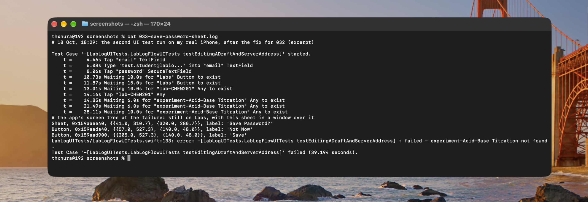 (log: `033-save-password-sheet.log`), and frames from the phone's screen recording: 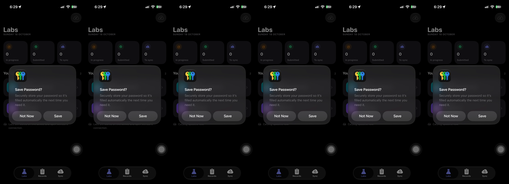
**Cause:** After a successful sign-in, iOS offers to save the password in the Passwords app (the fields are marked as a username and a password, so AutoFill works). Its sheet sits over the app and takes every tap until it is answered, so the three taps on the lab card never reached it. The simulator has no Passwords app, so it never showed this.
**Fix:** After signing in, the test taps **Not Now** if the sheet appears within 3 seconds. The app is unchanged: for a person this is the normal, useful iOS offer, and it is what lets the AutoFill of 032 work. The third run on my iPhone passed all 63 unit tests and all 6 UI tests against the hosted backend, then removed the 3 records, 3 photo files and 1 lab the test accounts had created.

### Failure 034
**After one student signed out, the next one landed on the previous student's last tab** · 18 Oct 2026

**Type:** UX bug, found by a new read-only check on my real iPhone
**What I was doing:** Checking sign-in, sign-out and the old data with the real demo accounts on my iPhone: the demo student signs in and their records come back from the server; they sign out; student2 signs in on the same phone and must see none of it. The server was audited before and after (unchanged: the demo student's 11 records, 10 submitted and 1 draft, with 46 step completions and 11 photos; 0 records for every test account; no stray photo files).
**Error / output:**
    Waiting 45.0s for "10, Submitted" StaticText to exist      # passed: the records were restored
    Tap "sign-out" Any
    Type 'student2@lablog.te...' into "email" TextField
    Waiting 15.0s for "0, Submitted" StaticText to exist
    LabLogFlowUITests.swift:530: error: -[LabLogUITests.LabLogFlowUITests testRealAccountRestoresAndSignOutClears] : XCTAssertTrue failed - no submitted records left behind
**Screenshot:** 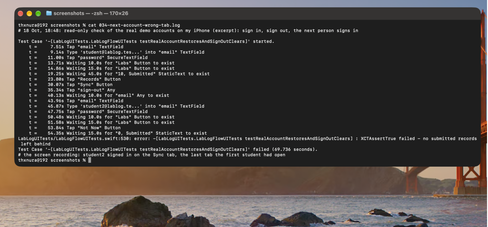 (log: `034-next-account-wrong-tab.log`), and frames from the phone's recording: 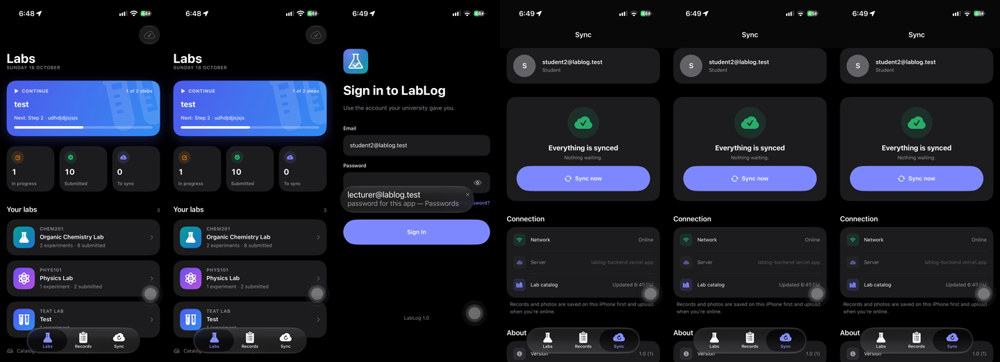
**Cause:** Nothing had leaked: the recording shows student2 on the **Sync** tab with "Everything is synced, nothing waiting". But Sync was the tab the first student had open when they signed out, and the home stats the check looks for are on Labs. The root view picks the starting tab when the *role* changes (lecturers start on Review), and two students in a row have the same role, so the tab was never reset. The comment above that code already said the next person should start on their first tab; only the navigation stack was reset.
**Fix:** The starting tab is now chosen whenever the signed-in *account* changes. The rerun on my iPhone passed: the demo student's 10 submitted records and 1 draft came back with their photos, sign-out returned to sign-in, and student2 landed on Labs with 0 records ("No lab records"). The server was unchanged afterwards. This check (`testRealAccountRestoresAndSignOutClears`) only runs when the `LABLOG_CHECK_*` variables are set, and writes nothing.

## AI prompts

Every prompt, quoted exactly as typed, with what it produced and whether it worked without a
correction (also in the report, §9.3).

| # | Exact prompt | What it produced | Result |
|---|---|---|---|
| 1 | "check the status of this project and install the app in my iphone" | Status review, the Xcode project, signing, and installation on my iPhone | Partially (failure 001) |
| 2 | "it shows scaffold ready, wire lab view and other stuff, build the full app, and if u detect errors, those should be screenshoted and make a doc" | The full app (store, sync, auth, screens, camera/GPS wiring, tests) and a build log | Partially (failure 002; a race in its record screen surfaced on 18 Oct as failure 019) |
| 3 | "i get this error repetatively" (with a screenshot of the crash dialog) | A diagnosis from the crash report and the fix | Worked |
| 4 | "its look too much basic, make ui ux more like other porffesional app design with apple design skills" | The design system and a redesign of every screen | Partially (failures 003, 004) |
| 5 | "yes and u shoeud authorize as me, do not include u" | Commits under my own identity | Worked |
| 6 | "add more interactibe animations like when timer goes show them in dynamic island and show interactive timer, and when we click step add step guide as well" | The Live Activity, timer dial, step guides and deep links | Partially (failures 005, 006) |
| 7 | "yes rewrite that commits and remove all clade coauth and add my photo and name" | A history rewrite with authorship preserved | Worked |
| 8 | "this submit dialog look ugly, fix it, also make dynamic island more good with details and make proffesional" | The review sheet and a richer Live Activity | Worked (fixed failure 007) |
| 9 | "yes continue and do next build" | The local Supabase stack, end-to-end tests, lecturer role, ownership checks, and real sync from the app | Partially (failures 008, 009) |
| 10 | "what more we have to build" | A gap analysis against this brief | Worked |
| 11 | "ok do next ones" | This report draft, its diagrams and figures, viva preparation, and the in-app lecturer review; checking the figures exposed failure 010 | Partially (failures 010, 011); report is a first draft for my review |
| 12 | "check what we more have to build" | A second gap check: submission tasks, the risk of a LAN-only backend at the viva, optional small builds | Worked |
| 13 | "ask me the points should be filled in Appendix D" | Questions on batch mates, assets and libraries; Appendix D filled from my answers | Worked |
| 14 | "termiansl erros all looks like styles neh, for this lets do this, make small mac app, not inside this repo. make it inside documemnt/thanura and when we fiving logs, inte rendered same to mac terminal and we can capture ss from it", then "look its huge different", "now this is too mcuh perfect, adding shadow and all…", "i said u to take ss like this" (with my own screenshot) | TermShot, a small Mac app that shows a saved log in a real Terminal window on my desktop and saves the screenshot; the error images were re-taken with it in the style of my own screenshot | Partially (window title, margin marks, inactive windows, a captured keystroke (failure 013) and two style rounds, all fixed) |
| 15 | "make word document" | `LabLog-Report.docx`, generated from the same Markdown (headings, tables, code, 14 images, page numbers) | Worked after two conversion bugs were fixed (lost spaces between links, a skipped image) |
| 16 | "so whats next we have to build" | A plan: a runtime server address first (the viva network risk), then discard draft, photo retake and step notes | Worked |
| 17 | "ok do next" | The four features above, across app and API, with 10 unit tests, 4 backend tests and a UI test; ADR-021 to 023 | Partially (failure 012 caught by the new UI test and fixed; the photo prune it added also deleted every new photo, found two days later as failure 018) |
| 18 | "so whats next" | A short plan: update the viva sheet, check dark mode, then stop adding features before the deadline | Worked |
| 19 | "so update md and do the checks" | `VIVA-PREP.md` rewritten for the current app (network setup, demo, new questions, a live-coding trap caught and verified); UI tests run in dark mode, 29 screens reviewed, Figure 13 | Worked (no fixes needed) |
| 20 | "i checked the readme and other stuff, i cant give this repos to sir, make it ready to submit" | Both repos prepared for a reader: new READMEs, the report PDF in the repo, the failure log reorganised (index, failures in order, prompts table), template notes and exam wording removed, a broken `lint` script dropped | Worked |
| 21 | "make repo public" | Full git history scanned for secrets (none), then both repos made public and checked without signing in | Worked |
| 22 | "btw in readme and dark mode ss" | The dark-mode figure added to the README | Worked |
| 23 | "btw make app more production ready, i mean this style online status look odd, make it production ready" (with a screenshot of the toolbar) | The "● Online 1" pill replaced by a quiet sync icon with an explanatory popover and Sync now (ADR-024), 4 unit tests, new screenshots | Partially (failure 017; the screenshot review found a signed-out icon that read as an account button, a notification left over from another test, "Your 0 records" wording and failure 018; the final full run found failure 019; all fixed. The popover still had no way to sign in: failure 020, reported from my iPhone) |
| 24 | "when i click here itd not prompt to signin, fix it" (with a screenshot of the sync popover from my iPhone) | A **Sign in** button in the signed-out popover that opens the sign-in sheet in place; the action modelled in `SyncIndicatorState` with a unit test; the UI test taps it | Partially (failure 020: the new UI test step failed first because the popover's identifier hid the button's, as in 005; fixed) |
| 25 | "signin takes too much time, check whats happening", then "i mean request timeout" | The cause found (the Mac's IP changed again); sign-in now fails in 8 s with a clear message and **Change server address**; a unit test; the fixed build on my iPhone | Worked (failure 021; the full run that followed found failure 022, fixed) |
| 26 | "push the db to supabase now cli done" | The linked hosted project got the schema, the seed and a new migration that turns on RLS for every table and creates the private photo bucket (ADR-025); checked with the service role and the anon key | Worked |
| 27 | "now create test user" | The three test accounts on the hosted project (same emails and roles, new private passwords, since the README's local passwords are public); each checked by signing in and reading its role from the token | Worked |
| 28 | "ok um ready to deply this in vercel, show me env to add", then "open .env" | The API made ready for Vercel's zero-configuration Express (default export of `src/app.ts`, ES module), checked locally; the four variables in a private file opened in VS Code, the service-role key kept out of the chat | Worked |
| 29 | "ok now make vercel,json" | `vercel.json` running the function in Seoul (`icn1`), next to the database | Worked |
| 30 | "https://lablog-backend.vercel.app test this" | A smoke test of the deployed API, as the app uses it (15 checks), with its test record cleaned up | Worked after one fix to the test itself: it looked for `guideSteps`, but the API returns `guide.steps` |
| 31 | "now point it in app" | iPhone builds use the hosted backend through a git-ignored, iPhone-only config; the simulator and tests stay local; the Server row is read-only and the sign-in error fits a hosted build; 2 unit tests; installed on my iPhone | Worked |
| 32 | "it show invalid password" (signing in as the lecturer on my iPhone) | Checked that the hosted lecturer account signs in (200) and that the phone's attempt reached the hosted server, not the Mac; the likely causes: an old saved password filled in by iOS, or a typo | Worked (no fault found in the app) |
| 33 | "also when we logout it show offline data, fix it" | Sign-out clears the phone's records with a warning for unsent work, an open record closes itself, a unit test and a UI check (ADR-026) | Worked (failure 024) |
| 34 | "in assignmnt check is there any requirmen to keep guest login without signin", "check this" (the brief), "no i need to check are we need to keep guest login without signin" | The brief read in full: it never mentions login, accounts or guests; it requires a backend and offline work that syncs back, so either model meets it | Worked |
| 35 | "so dont allow them to use app without signin, keep offline sync as but when they logout do not allow, like whatsapp work" | The app opens on sign-in and can't be used signed out; offline after the first sign-in; sign-out returns to sign-in and clears the phone; a local build can change the server from the sign-in screen; UI tests sign in at launch (ADR-027) | Worked |
| 36 | "make login ui more good with apple design and make settngs page more good ui ux" | A first redesign: a welcome screen with a glowing brand mark and three feature rows, and a Settings-style Sync page (account card, sections, Sign Out at the bottom) | Partially: I said it looked too "vibe coded" |
| 37 | "its lokk too vibe coded, mak it simple", then "i need simple but proffesional one", then "only show the version, no need to show the server data in login" | Sign-in rebuilt plainly: the real app icon, "Sign in to LabLog", labelled Email and Password fields with show/hide, "Forgot password?" (accounts are reset by the university), one Sign In button, only the version at the bottom; the Sync page's account card as a plain monogram | Worked after the three rounds |
| 38 | "ok i found a bug, when i signin and check my prevous lab subsmition, there are missing , fix it" | `GET /api/records/mine` (backend, deployed), restoring records and their photos after sign-in (app), tests at every level, the fix on my iPhone (ADR-028) | Worked (failure 026; Docker had also stopped, failure 025) |
| 39 | "lecturers no need access labs neh, they will not do the labes neh, add option to create labs to lecturers , and poin who can do this" (with a screenshot of the lecturer's Records tab); my answers: the lecturer picks the students, full step rules | Lecturer tabs Review · Labs · Sync; create a lab, add experiments with photo, wait and prerequisite rules (checked by the constraint engine in the app and with Kahn's algorithm on the server), choose students; students see only open or enrolled labs (ADR-029); backend, unit and UI tests; deployed and installed | Worked (failure 027 on the way, from the restore feature) |
| 40 | "when we click save and create, its wait until backend respond, make it optimized" | Create answers with the new lab or experiment whole (server step ids) and the app adds it to its store and closes the sheet at once, with no catalog refetch; choosing students saves optimistically and reverts on failure; the catalog refresh fetches experiments concurrently instead of one by one | Worked |
| 41 | "make student choose ui more good" | The student picker rebuilt: a monogram, name and email per student, a checkmark circle that fills when chosen, "2 of 5 selected" with Select All, always-visible search, empty and no-results states, Save only when something changed | Worked |
| 42 | "also we cant change exiting expermants steps fix it", then "and make ui better of them" | Editing experiments: `PUT /api/manage/experiments/:id` keeps step ids and refuses to remove a step with students' work (backend test); one editor for new and existing experiments; step rows with a numbered circle and rule symbols (camera, timer, after); experiment rows showing steps, photos and timers; unit test and the lecturer UI test now edits an experiment | Worked |
| 43 | "i created test lab and counter now not going check why, also dynamic island not working" | Found the engine's fallback to *now* for a wait with no prerequisites; the wait now runs from the record's start in the engine, the Live Activity and the checklist component; two unit tests; installed on my iPhone | Worked (failure 028; Docker had quit again during the tests, failure 029; checking the fix found failures 030 and 017e, both in the tests) |
| 44 | "is all done" | A status check of both repos: everything committed, the iOS repo 8 commits ahead of GitHub; the items only I can do (read and submit the report, reinstall before the signing expires, turn off public sign-up, Docker, viva practice) | Worked |
| 45 | "push as me" | The 8 iOS commits checked for my authorship and no co-author lines, then pushed | Worked |
| 46 | "did u update the doc ss and markdoen and all" | An audit of the shared doc, screenshots and Markdown. Fixed: four doc sections still showing old screens, the doc's summary, the iOS README ("sign in from the Sync tab", no lecturer figure), the screenshots README and the viva notes; README changes pushed | Worked (gaps found and fixed) |
| 47 | "update the report as well" | A full read of the report against the app. Updated: lecturer lab authoring in the idea, the read path, the API table, the constraint chapter (a wait anchored on the record's start; validation when an experiment is written), the checklist's `startedAt`, the lecturer components, the failure and test notes, my own role, limitations; PDF and Word rebuilt | Worked |
| 48 | "ok what are the more gaps have, also do not use docker, us the vercel link for testog and make finalzie" | A gap check against the brief; every test moved to the hosted backend (ADR-030): test-only accounts, the backend suite against the deployed API, the simulator and UI tests on the hosted build, a clean-up before and after each run; docs, report and both repos finalised | Worked (failure 031, in the new script) |
| 49 | "did u test all the steps screen in iphone and backend", then "check now" | An honest answer: the UI tests had run on the simulator against the hosted backend, not on my iPhone; then all the tests run on my iPhone 17 Pro against the hosted backend. Two iPhone-only test failures from the Passwords app (032, 033) fixed in the tests; the third run passed 63 unit and 6 UI tests on the phone | Worked (failures 032 and 033) |
| 50 | "what is the test frameword we used" | XCTest for the 63 unit tests, XCUITest for the 6 UI tests, and Node's built-in test runner (`node:test`, `node:assert`, through `tsx`) for the 20 backend tests; no third-party test framework | Worked |
| 51 | "check signin and signout and check old data and remaining" | A read-only audit of the hosted project (accounts, each account's records and photos, labs, stray files: all clean), the restore checked through the deployed API, and a new on-demand UI check on my iPhone with the real demo accounts: records restored, sign-out, the next student sees nothing. It found a UX bug (034), fixed; the rerun passed and the server was unchanged | Worked (failure 034) |
| 52 | A pasted list of review points on the report (the hosted backend vs the changeable server in Section 4, Figure 13 and failure 015; Appendix A's on-device mode vs ADR-027; failure 012 vs Figure 12; 30 vs 29 screenshots; the unnumbered redesign image; a thin Section 2.3, self-referential references, repeated hedging, a small Figure 2), then "update these in exiting document, do not change the doucmnet only content" | Content-only fixes in the report source, rebuilt with the report's own Word pipeline: each point corrected; Section 2.3 rewritten; nine external references [6]-[14] checked against Crossref and cited; repeated caveats kept once, in Section 11; Figure 2 redrawn larger; Figure 13 showing the hosted build; failures 032-034 and the iPhone runs added. Paused when another session was editing the report at the same time | Worked (finished after prompt 53) |
| 53 | "LabLog-Report.docx is the final version.", then "check now" | The rebuilt report swapped into Word (the open copy had nothing unsaved), contents page updated and PDF exported with the finalize script (59 pages); figures, contents and references checked page by page; the repository copies updated | Worked (Word's field-update prompt needed a second open) |
| 54 | "so cgeck last final check, is there any hidden things in pdf or  ready to submit" | A final check of the submitted PDF: metadata, embedded files, scripts, links, hidden or white text and tracked changes in the Word source, secrets, local paths, template leftovers, all 42 contents page numbers. It found one stale sentence in Appendix F, which I chose to delete; it was removed in Word, the PDF re-exported, the title and author kept, and the PDF's internal cross-reference table repaired (every page renders the same) | Worked |

### Notes on selected prompts

### Prompt 1 — Create the Xcode project and install on the iPhone (12 Oct)
**Type:** AI-prompt
**What I was doing:** The repo only had source files (no `.xcodeproj`), so nothing could build or run.
**AI prompt used:**
    > check the status of this project and install the app in my iphone
**AI result:** worked — Claude Code wrote `LabLog.xcodeproj` (file-system-synchronized groups, shared `LabLog` scheme, generated Info.plist with camera + location usage strings), ran the unit tests on the simulator, built and signed it with my Personal Team (automatic signing, `-allowProvisioningUpdates`), and installed + launched it on my iPhone 17 Pro (iOS 27.2) with `xcrun devicectl`. The app installed fine but only shows the placeholder `RootView`, because the screens aren't wired up yet. See ADR-007.

### Prompt 2 — Build the full app (12 Oct)
**Type:** AI-prompt
**AI prompt used:**
    > it shows scaffold ready, wire lab view and other stuff, build the full app, and if u detect errors, those should be screenshoted and make a doc
**AI result:** partially. Claude built the SwiftData store, outbox SyncEngine (photos first, batches of ≤100, per-item results, backoff 2→32 s), Supabase sign-in, the bundled catalog, all screens, camera + GPS wiring, 28 unit tests and 2 UI tests, and fixed backend contract mismatches (ADR-014). The first test run crashed (entry above). Errors and screenshots were also collected in a shared doc.

### Prompt 14 — Error screenshots in a real Terminal window (TermShot) (15 Oct)
**Type:** AI-prompt
**What I was doing:** The error images for 001–011 were drawn from the captured logs by a script. They didn't look like macOS Terminal (custom title, `$` prompts, different colours), so I asked for a tool that shows a log in a real Terminal window to screenshot.
**AI prompt used:**
    > termiansl erros all looks like styles neh, for this lets do this, make small mac app, not inside this repo. make it inside documemnt/thanura and when we fiving logs, inte rendered same to mac terminal and we can capture ss from it
    > look its huge different   (with a screenshot of my real Terminal next to the old image)
**AI result:** worked. Claude Code built TermShot, a small SwiftUI Mac app kept outside the repo (`~/Documents/thanura/TermShot`). It turns a log into a zsh script and opens it in a real Terminal.app window. The window shows the prompt and command, then the exact captured output, and ends at a live `-zsh` prompt. Optionally it saves the window as a PNG with `screencapture -l`. Two problems came up on the way:
1. Opening the script as a `.command` file titled the window after the file. Fixed by opening a normal window with AppleScript `do script`.
2. Pressing Return there left Terminal "mark" lines in the margin. Fixed by resetting the terminal (`ESC c`) before replaying.

From now on, error screenshots are replays of the exact captured output in Terminal. The command and output are real, but the window is a replay, not the original run.

Also on 15 Oct I re-took the screenshots for 001, 002, 004, 005, 006, 008, 009, 010 and 011. Each new PNG shows a real Terminal window running `cat` (for 001, `head` and `tail`) on the `.log` saved on the day of the failure. The logs themselves are unchanged. They are excerpts, and their `#` lines are notes I added at the time. Problems that came up during the re-take:
- Three captures caught Terminal in the background (grey buttons, hollow cursor). macOS doesn't always let another app take focus. TermShot now brings the window forward, checks the saved image for the red close button, and retakes it if the window wasn't active.
- My next prompt: "now this is too mcuh perfect, adding shadow and all, screenshots are croped and sometimes at background, fix it", then "no still perfect, i mean not have background and random crops". The images had a large drop shadow, and each window was a different size cut tightly around its text. They are now the window alone, with no shadow, all 120 columns wide and at least 24 rows tall, like a normal Terminal window. That still looked too staged ("still its same neh too perfect"). So I sent a screenshot of my own Terminal on the desktop ("i said u to take ss like this"). The final style matches it: a 120-column window on my real desktop wallpaper, with a loose, uneven crop that sometimes cuts through the window's empty edge but never through text. TermShot captures only the wallpaper and the Terminal window, using ScreenCaptureKit, so other apps, widgets and desktop icons never appear.
- With Preview full screen, the new Terminal windows opened on the desktop Space, and TermShot looked for them before macOS had switched there ("The Terminal window isn't on screen"). It now activates Terminal first, waits for the Space switch, and retries.
- In windows taller than 24 rows, Terminal's prompt marks came back. Fixed by waiting for the resize to finish before resetting.
- One capture picked up an old Terminal window left open by an earlier test. TermShot now finds its window by its tty, and `--cleanup` closes leftover windows.
- The 008 log's `curl` line was shortened with "…" when it was saved. It is shown as-is, not as raw curl output.

### Prompt 15 — Word version of the report (15 Oct)
**Type:** AI-prompt
**AI prompt used:**
    > make word document
**AI result:** worked with two fixes. `LabLog-Report.docx` is generated from the same Markdown with python-docx: headings, tables, code blocks, the 14 images and a page-number footer. The first build had two bugs, both fixed and checked: a whitespace trim removed the spaces around "·" between two hyperlinks, and an image that wasn't wrapped in a paragraph was skipped.

### Prompts 16–17 — Server address, discard draft, photo retake, step notes (16 Oct)
**Type:** AI-prompt
**AI prompt used:**
    > so whats next we have to build
    > ok do next
**AI result:** partially. Claude Code proposed, then built:
1. **Sync → Server:** change the backend address at runtime and test it. The API now rewrites storage URLs to the host the app called (ADR-021).
2. **Discard draft:** syncs a tombstone to the server (ADR-022).
3. **Photos and notes:** photo retake (plus remove until the step is done) and per-step notes. The sync payload now carries the full photo set (ADR-023).

Tests now number 47 unit, 14 backend end-to-end and 5 UI. The new UI test failed once (failure 012) before the fix.

### Prompts 18–19 — Dark-mode check and demo notes (16 Oct)
**Type:** AI-prompt
**AI prompt used:**
    > so whats next
    > so update md and do the checks
**AI result:** worked.
- **Demo notes:** my own setup and demo notes (kept outside this repo) were brought up to date with the current app: network setup, demo steps and test counts. While writing a practice exercise, Claude Code caught a trap: a non-optional `Bool = false` added to the `Codable` `Step` compiles, but makes catalog decoding throw `keyNotFound`. It was verified with a scratch decode.
- **Dark mode:** the titration, timer/Dynamic Island and editing UI tests were run with the simulator in dark appearance. All passed, and all 29 screenshots were reviewed. Nothing needed fixing: colours are semantic, white text only sits on coloured fills, and shadows are dropped in the dark. Added as Figure 13 in the report.

